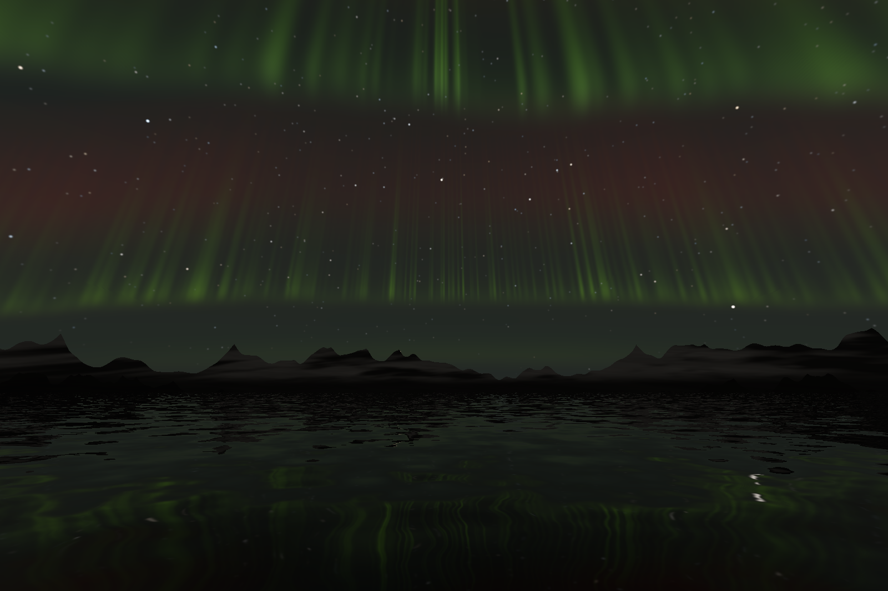
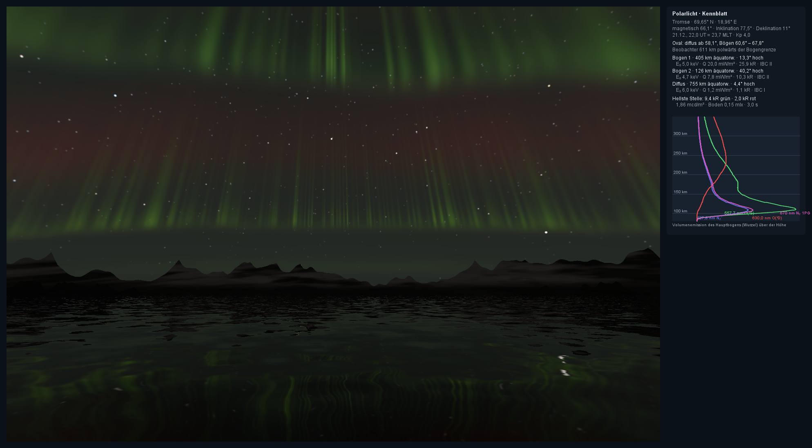
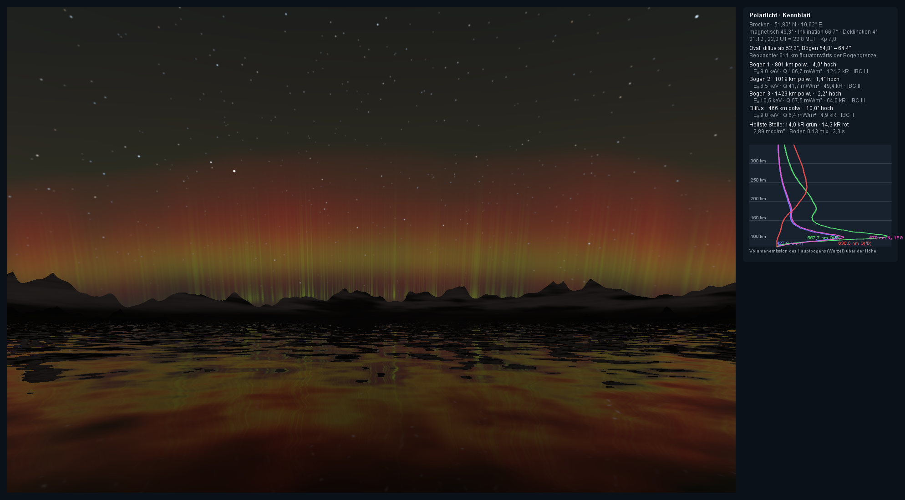
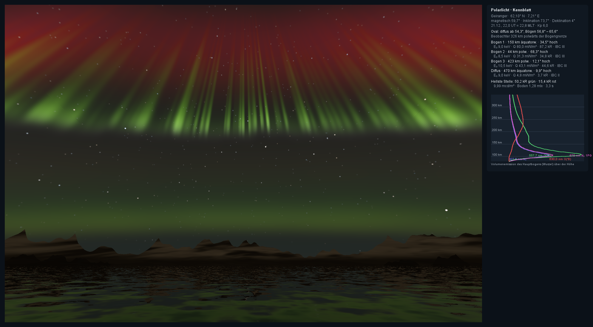

# com.dan.aurora – Polarlicht

**Stand: Phase 1 (09.11.2026).** Nordlicht und Südlicht aus Ort, Datum, Weltzeit und Kp-Index, physikalisch gerechnet: Das Oval sagt, wo die Vorhänge stehen, das Erdmagnetfeld, wie die Strahlen liegen, der Niederschlag der Elektronen, in welcher Höhe es leuchtet, und vier Spektrallinien, in welcher Farbe. Heraus kommen Kilorayleigh je Linie für jede Blickrichtung, daraus cd/m², Farben und schließlich das Bild einer Kamera oder des dunkeladaptierten Auges.

- **Phase 1** rechnet alles auf dem Prozessor und malt Standbilder: Vorhänge mit Falten und Strahlen über einer Winterbucht mit Sternen, Bergen und Spiegelung (dieses Dokument).
- **Phase 2** bringt den Strahlengang als Fragment-Shader auf die Grafikkarte (`gl/`), in Echtzeit, mit Drift und Flattern.
- **Phase 3** macht die Dynamik: Substurm (Aufbruch in Minuten), pulsierende Flecken, Flackern der Strahlen, Korona im magnetischen Zenit.
- **Phase 4** gibt das Licht an die Landschaft: Bestrahlungsstärke als Kugelflächenfunktionen für Schnee, Eis und Wasser, und das Oval für ganze Nächte (Kp aus einer Zeitreihe).
- **Phase 5** nimmt Himmel und Gelände von außen über eine kleine Schnittstelle, etwa aus `sky` (Sterne, Dämmerung, Mond) und `horizon` in einer App wie Lituya Bay oder Brocken.

Der Kern braucht nur Java 21, `demo/` zusätzlich FStyle. Zum Herauskopieren reicht `src/com/dan/aurora/`. Die Bilder in `templates/` (Fotos) sind nur zum Anschauen da; sie sind nicht im Repository, und das Paket misst nichts an ihnen – die Quelle ist hier die Physik.





## Benutzung

```java
Aurora a = Aurora.aktiv();            // oder ruhig(), ausbruch(), rot(), kp(5.5)
a.ort = Ort.lofoten();                // Breite, Länge, Deklination; eigene Orte: new Ort("…", 60.1, 7.2, 4)
a.kp = 4; a.monat = 12; a.tag = 21; a.ut = 22;
a.vorbereiten(0);                     // Oval, Feld, Vorhänge, Profile (etwa 50 ms)

double[] kr = new double[Emission.LINIEN];
a.strahlung(0, 0.7, 0.714, kr);       // Blick (Ost, Nord, oben) → kR in 427,8 · 557,7 · 630,0 · 670 nm
double cd = Spektrum.leuchtdichte(kr);           // cd/m²
double[] rgb = new double[3];
Spektrum.rgb(kr, rgb);                           // lineares sRGB, Y in cd/m²
int pixel = Spektrum.kamera(rgb[0], rgb[1], rgb[2], 8, 3200, 2.8);  // 8 s, ISO 3200, f/2,8
System.out.println(a.helligkeit());              // „25,9 kR in 557,7 nm (IBC II), 5,43 mcd/m² senkrecht“
a.zeit(30);                                      // Falten und Strahlen 30 s weiter, Profile bleiben
```

## Was gerechnet wird

### Wo: das Oval und der Ort im Magnetfeld

| Größe | Wie | Quelle |
|---|---|---|
| Magnetische Breite und Länge | Exzentrischer Dipol aus den ersten acht Gauß-Koeffizienten des IGRF-13 (2020); Mittelpunkt 590 km vom Erdmittelpunkt (−398, 372, 228 km), Pol 80,6° N 72,7° W | Fraser-Smith 1987, Alken u. a. 2021 |
| Inklination der Feldlinien | tan I = 2 tan Λ. Tromsø 77,5°, Hamburg 68°. Die Strahlen liegen entlang der Feldlinien und lehnen darum äquatorwärts; sie laufen im **magnetischen Zenit** zusammen (Höhenwinkel = I, äquatorwärts) | Dipol |
| Deklination | Vom echten Feld (WMM 2025, je Ort als Zahl), weil der Dipol sie in Europa um 30° verfehlt; `NaN` nimmt die Peilung zum Dipolpol | WMM |
| Magnetische Ortszeit | 12 h, wenn der Ort auf dem magnetischen Meridian des sonnennächsten Punkts steht. Tromsø: 22 UT = 23,7 MLT | Baker und Wing 1989 |
| Äquatorgrenze der diffusen Aurora | 66,1° − 2,0°·Kp um Mitternacht, zur Tagseite bis 8° polwärts | Gussenhoven, Hardy, Heinemann 1983; Feldstein und Starkov 1967 |
| Diskrete Bögen | 2,5° polwärts davon bis 6,5° + 0,8°·Kp. Tromsø liegt bei Kp 2 darunter; Hamburg sieht bei Kp 3 nichts (Unterkante 1° unter der Kimm) und bei Kp 8 Bögen 30° hoch | ebd. |

Die Bögen stehen im Oval, in Kilometern vom Beobachter (1° = 111 km), gekrümmt wie das Oval (Radius R·tan(90° − Λ), biegt polwärts). Mit Erdkrümmung erscheint die Unterkante in 1 300 km hinter der Kimm, das Rot in 250 km Höhe steht noch darüber – darum sieht Norddeutschland bei Kp 7 einen roten Nordhorizont mit grünen Strahlenspitzen.

Der exzentrische Dipol trifft die korrigierten geomagnetischen Breiten in Europa auf ±1°, in Kanada und Alaska auf ±2° (Tromsø 66,1° statt 66,6°, Hamburg 51,1° statt 50,5°, Hobart −54,4° statt −54,6°).

### In welcher Höhe: der Niederschlag

Die Elektronen kommen mit einem **Maxwell-Spektrum** der charakteristischen Energie E₀ (mittlere Energie 2·E₀) und dem Energiefluss Q in mW/m² (= erg/cm²/s), dazu ein weicher Anteil (`weich`, 15 % bei 0,2 keV), der das Rot oben macht. Jede Energie dringt bis zu ihrer **Reichweite** in Massensäule ein, R = 4,30·10⁻⁷ + 5,36·10⁻⁶·E^1,67 g/cm², und gibt ihre Energie nach der Funktion λ(s) für isotropen Einfall ab (Rees 1989, tabelliert). Je 35 eV ein Ionenpaar. Die Luft kommt aus der US-Standardatmosphäre 1976 und MSIS, oberhalb 150 km auf die Nacht gedrückt; die Massensäule über 100 km ist 3,4·10⁻⁴ g/cm².

| E₀ | Maximum der Ionisation | 557,7 nm | 630,0 nm | 630,0/557,7 | 557,7/427,8 |
|---|---|---|---|---|---|
| 0,2 keV | 182 km | 186 km | 239 km | 0,97 | 10,8 |
| 1 keV | 126 km | 128 km | 230 km | 0,18 | 6,0 |
| 3 keV | 108 km | 110 km | 232 km | 0,04 | 4,2 |
| 5 keV | 103 km | 105 km | 233 km | 0,02 (0,29 mit weichem Anteil) | 3,4 |
| 10 keV | 97 km | 101 km | 234 km | 0,01 | 2,3 |

(Reine Maxwell-Spektren ohne weichen Anteil, senkrechte Säule.) Ein Bogen mit 10 mW/m² bei 5 keV gibt senkrecht 11 kR in 557,7 nm, also IBC II.

### Welche Farbe: vier Linien

| Linie | Woher | Wie gerechnet |
|---|---|---|
| **427,8 nm** N₂⁺ 1NG, blau-violett | sofort bei der Ionisation von N₂ | 0,021 Photonen je N₂-Ionisation; am stärksten am unteren Saum |
| **557,7 nm** O(¹S), grün | Anregung von O, Lebensdauer 0,7 s | 0,05 + 0,12·(O-Anteil) je Ionenpaar; unterhalb 95 km von O₂ gelöscht (k = 3·10⁻¹³ cm³/s) |
| **630,0 nm** O(¹D), rot | Anregung von O und Zerfall von O(¹S), Lebensdauer 110 s | A₆₃₀ = 5,63·10⁻³ s⁻¹; Löschung durch N₂ (2,0·10⁻¹¹·e^(107,8/T)), O₂ und O; darum nur oberhalb 200 km. Wegen der Lebensdauer wird das Rot **breiter und ohne Kräusel** gemalt (es hinkt der Bewegung hinterher) |
| **670 nm** N₂ 1PG, rot (für die sichtbaren Banden 600–700 nm) | sofort bei der Anregung von N₂ | 0,025 je N₂-Ionisation; mit dem Blau zusammen der **purpurne Saum** harter Vorhänge |

Die Linien werden mit CIE 1931 (2°) zu XYZ und zu linearem sRGB; Linienfarben liegen außerhalb des Farbraums und werden mit Weiß aufgefüllt, die Leuchtdichte bleibt. **1 kR in 557,7 nm = 2,83·10⁻⁷ W/m²/sr = 1,93·10⁻⁴ cd/m².** Damit stimmt die IBC-Skala: I = 1 kR (Milchstraße), II = 10 kR, III = 100 kR (Wolke im Mondlicht), IV = 1 000 kR.

**Auge und Kamera.** Die Kamera rechnet mit der Lichtwertformel (L·t·S/(12,5·N²) = 1 gibt Mittelgrau), die Lichter laufen weich aus. Das Auge sieht unter 10⁻³ cd/m² nur mit den Stäbchen: grau, und für die ist 630 nm fast unsichtbar (V′ = 0,003 gegen 0,365 bei 557,7 nm). Erst über etwa 0,1 cd/m² – IBC III – kommt die Farbe. Darum sind Fotos bunt und das Nordlicht vor Ort oft grau-grün.

**Extinktion.** Die Vorhänge stehen über der ganzen Luft. Optische Dicke 0,15 im Zenit bei 557,7 nm (80 % Rayleigh ∝ λ⁻⁴, 20 % Dunst), Luftmasse nach Kasten und Young (1989). Am Horizont bleiben 5 %, und das Blau geht zuerst.

### Wie geformt: Vorhänge

Ein `Vorhang` ist die Fußlinie des Niederschlags auf der Schale in 100 km Höhe und sein Höhenprofil:

- **Falten** in vier Größen nach Hallinan und Davis (1970): Spiralen (320 km, ±45 km), Falten (100 km, ±14 km; 30 km, ±4,5 km), Kräusel (9 km, ±1,4 km), alle mit `faltung` 0..1 skaliert und mit der Zeit in Bewegung.
- **Quer** eine Gaußglocke von `breite` km (3 km, Vorgabe). Weil die Glocke dünn ist und die Abtastung grob, wird sie um den Schritt der Abtastung verbreitert (Kastenfilter); das Integral bleibt. So flimmern dünne Vorhänge nicht.
- **Strahlen** teilen den Fluss (`strahlen` 0..1): schmale Streifen von 2,5 km in Bündeln von 35 km, mit weicherem Spektrum (E₀/2,5), darum reichen sie höher. Die Helligkeit entlang der Linie schwankt zudem über 200 km.
- Die **Strahlen liegen entlang der Feldlinien**: Jeder Punkt in der Höhe h wird um (h − 100 km)·cot I äquatorwärts auf seine Fußlinie zurückgerechnet. Darum lehnen sich die Strahlen, und über dem Beobachter laufen sie im magnetischen Zenit zusammen.
- **Drift** entlang der Linie (abends westwärts, morgens ostwärts) und Bewegung quer dazu, die das Rot verbreitert (σ² + (55 s·v)²).
- Mehrere Bögen stehen über das Oval verteilt; der erste ist der hellste. Dazu die **diffuse Aurora** äquatorwärts: 70 km breit, hart (≥ 6 keV), 6 % des Flusses.

Der **Strahlengang** marschiert in der Höhe (1,25 km bei HIGH) durch die Schale, mit Erdkrümmung; oberhalb des feinen Teils (Grün, Blau, Purpur) nur noch das glatte Rot in vierfachen Schritten. Je Blickrichtung etwa 18 µs; ein Bild in 1 000 px braucht 0,8 s, in 1 600 px 2 s (8 Kerne). Die Qualitätsstufen unterscheiden sich im Integral über den Himmel um unter 1 %.

## Die Demo

`demo/AuroraDemo` zeigt die Bucht (`demo/AuroraSzene`): Sterne nach der Häufigkeit ihrer Größenklassen, Nachthimmel 2·10⁻⁴ cd/m² mit Aufhellung zum Horizont, eine verschneite Kette, deren Schnee das Polarlicht grün färbt (die Bestrahlungsstärke wird einmal je Bild über den Himmel integriert: 0,16 mlx bei Kp 4), und Wasser mit Spiegelung nach Fresnel und Wellen, die die Spiegelung in die Länge ziehen. Alles in cd/m², erst zuletzt für Kamera (2, 8 oder 20 s bei f/2,8 und ISO 3200) oder Auge gewandelt.

Regler: Ort (12 Presets von Tromsø bis Hobart, darunter Lituya Bay, Geiranger, Sylt, Hamburg, Brocken), Preset oder Kp, Qualität, Sicht, E₀, Q, Faltung, Strahlen, Blick, Weltzeit, Zeit, Neu würfeln. Das Kennblatt rechts zeigt Ort im Feld, Oval, jeden Vorhang mit Entfernung, Höhenwinkel, kR und IBC, die hellste Stelle im Bild und die Höhenprofile der vier Linien.

```bash
java -cp "build/classes;lib/*;src" com.dan.aurora.demo.AuroraDemo
```

```bash
java -cp "build/classes;lib/*;src" com.dan.aurora.demo.AuroraDemo --bild aurora.png aktiv tromso HIGH 1 --blatt
```

```bash
java -cp "build/classes;lib/*;src" com.dan.aurora.demo.AuroraCheck
```

`--bild datei.png [preset|kp] [ort] [LOW|MEDIUM|HIGH|ULTRA] [seed] [--blatt]`: Presets ruhig, aktiv, ausbruch, rot oder eine Zahl als Kp; der Ort als Anfang seines Namens.





## Aufbau

| Klasse | Aufgabe |
|---|---|
| `Aurora` | Offene Werte, Presets `ruhig()`, `aktiv()`, `ausbruch()`, `rot()`, `kp(n)`; `vorbereiten(t)`, `strahlung(…)` (kR je Linie), Auskunft (Höhenwinkel, Azimut, Helligkeit, IBC) |
| `Magnetfeld` | Exzentrischer Dipol: magnetische Breite und Länge, Inklination, Peilung zum Pol, magnetische Ortszeit |
| `Oval` | Grenzen nach Kp und MLT, Höhenwinkel mit Erdkrümmung |
| `Ort` | Beobachtungsorte mit Deklination; zwölf Presets |
| `Atmosphaere` | N₂, O₂, O, Dichte, Temperatur und Massensäule 80–400 km |
| `Niederschlag` | Maxwell-Spektrum, Reichweite, λ(s), Ionisationsrate über der Höhe |
| `Emission` | Die vier Linien aus Ionisation und Zusammensetzung; Säulen in kR; IBC |
| `Spektrum` | kR → W/m²/sr → XYZ → sRGB; Leuchtdichte photopisch und skotopisch; Kamera und Auge |
| `Vorhang` | Fußlinie mit Falten, Strahlen und Helligkeit in Tabellen je Stufe; Höhenprofile |
| `Rauschen` | Hash und Wertrauschen aus dem seed |
| `demo/AuroraSzene` | Die Bucht: Sterne, Berge, Wasser, Sichten |
| `demo/AuroraDemo` | Fenster mit Kennblatt; `--bild` |
| `demo/AuroraCheck` | 40 Prüfungen ohne Fenster, endet mit „Alles in Ordnung.“ |

## Grenzen (Phase 1)

- Der Dipol ersetzt das echte Feld: ±1° magnetische Breite in Europa, ±2° in Nordamerika. Die Deklination kommt als Zahl je Ort.
- Das Oval ist eine Statistik nach Kp; ein einzelner Abend weicht um Grad ab, und der Substurm (Aufbruch, Ausdehnung, Erholung) kommt erst in Phase 3.
- Falten sind seitliche Verschiebungen der Fußlinie; echte Spiralen und Wirbel (Kelvin-Helmholtz) schließen sich zu Schleifen (Phase 3).
- Die Ausbeuten der Linien sind so gesetzt, dass die beobachteten Verhältnisse herauskommen; ein vollständiges Modell (Energietransport, Sekundärelektronen, N₂(A) → O(¹S)) ist nicht drin.
- Kein Mond, keine Dämmerung, kein Zodiakallicht; die Szene ist Winter bei Neumond. Mondlicht und Dämmerung gehören zu `sky`, das Polarlicht kommt in Phase 5 dort dazu.
- Nur auf dem Prozessor (Phase 2 macht den Shader).

## Quellen

- Rees, M. H. (1989): Physics and Chemistry of the Upper Atmosphere. Cambridge University Press (Reichweite, λ(s), Ausbeuten, Löschung).
- Rees, M. H., Luckey, D. (1974): Auroral electron energy derived from ratio of spectroscopic emissions. J. Geophys. Res. 79, 5181.
- Gussenhoven, M. S., Hardy, D. A., Heinemann, N. (1983): Systematics of the equatorward diffuse auroral boundary. J. Geophys. Res. 88, 5692.
- Feldstein, Y. I., Starkov, G. V. (1967): Dynamics of auroral belt and polar geomagnetic disturbances. Planet. Space Sci. 15, 209; Holzworth, R. H., Meng, C.-I. (1975): Mathematical representation of the auroral oval. Geophys. Res. Lett. 2, 377.
- Hallinan, T. J., Davis, T. N. (1970): Small-scale auroral arc distortions. Planet. Space Sci. 18, 1735.
- Fraser-Smith, A. C. (1987): Centered and eccentric geomagnetic dipoles and their poles, 1600–1985. Rev. Geophys. 25, 1; Alken, P. u. a. (2021): International Geomagnetic Reference Field: the thirteenth generation. Earth Planets Space 73, 49.
- Baker, K. B., Wing, S. (1989): A new magnetic coordinate system for conjugate studies at high latitudes. J. Geophys. Res. 94, 9139.
- Chamberlain, J. W. (1961): Physics of the Aurora and Airglow. Academic Press (IBC-Skala, Rayleigh).
- Streit, G. E. u. a. (1976): Temperature dependence of O(¹D) rate constants. J. Chem. Phys. 65, 4761; Wiese, W. L., Fuhr, J. R., Deters, T. M. (1996): Atomic transition probabilities of carbon, nitrogen, and oxygen. J. Phys. Chem. Ref. Data Monogr. 7.
- Kasten, F., Young, A. T. (1989): Revised optical air mass tables and approximation formula. Appl. Opt. 28, 4735.
- US Standard Atmosphere 1976; Picone, J. M. u. a. (2002): NRLMSISE-00. J. Geophys. Res. 107, 1468.
- Lawlor, O. S., Genetti, J. (2011): Interactive volume rendering aurora on the GPU. J. WSCG 19, 25 (Vorbild für Phase 2).
