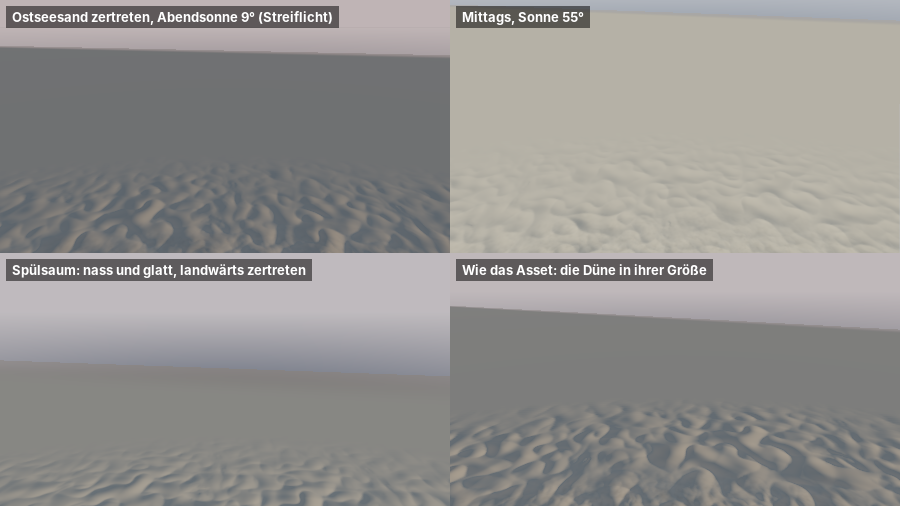

# com.dan.beach – Strand aus einem Asset



Relief und Korn des Sands in der Nähe des Auges, entstanden für Timmendorf. Die Karten sind aus einem Sand-Asset gebacken: `sand_dunes_gltf.zip`, „Main sand dune“ aus Fab, glTF 2.0 mit rund 500 000 Dreiecken und Texturen zu 2048². Das Package braucht das Asset selbst nicht, nur die gebackenen Karten `relief.png` und `grain.png` (je 1024², 16 Bit). Der Kern braucht nur Java 21 (`javax.imageio` liest die Karten), `gl/` zusätzlich JOGL, `demo/` zusätzlich `FStyle.jar`.

Zum Herauskopieren reicht `src/com/dan/beach/`.

## Was es kann

- **Relief aus dem Asset**: Mulden, Kämme und Rinnen des Netzes, ohne den großen Hügel, kachelbar, auf mittlere Abweichung 1 gebracht. Die Oberfläche legt zwei Oktaven übereinander; die zweite ist kleiner (0,43) und um 37° gedreht, so fallen die Kacheln nicht auf.
- **Nach dem Ort**: auf trockenem Sand voll, auf nassem geglättet (die Wellen ebnen ihn, 25 %), wo viele gehen zertreten, sonst ruhiger (45 %).
- **Korn** aus der Grundfarbe des Assets: Helligkeit ohne ihr Mittel über 15 cm, also Muschelgrus, dunkle Minerale und Flecken. Dazu sind Mulden etwas dunkler und Kämme heller.
- **Licht ohne Kante**: Bei tiefer Sonne wäre rauer Sand im Mittel heller als ebener. Die Mulden werfen aber Schatten aufeinander. `beachSurface` gibt deshalb einen Faktor auf das Sonnenlicht zurück, der das Relief im Mittel so hell macht wie ebenen Sand. Wo es in der Ferne ausgeht, entsteht so keine Kante.
- **Ohne Grafikkarte**: `heightAt`, `normalAt`, `albedoAt`, `slopeRms`, `sunFactor`.
- **Für jede Szene**: `gl/beach.glsl` wird in den eigenen Geländeshader eingesetzt. `BeachGl.bind` setzt Textur und Werte, der Shader ruft `beachSurface(p, n, pxm, dist, trocken, zertreten, sonne)` dort auf, wo Sand liegt.
- **Presets**: `ostsee()` (Timmendorf: Kachel 2,4 m, 2,2 cm), `nordsee()` (gröber, vom Wind), `duene()` (das Asset in seiner Größe: Kachel 6 m, 11,7 cm).

## Benutzung

```java
Beach strand = Beach.ostsee();
strand.quality = Beach.Quality.HIGH;          // Relief bis 200 m um das Auge
BeachGl gl = new BeachGl();
gl.init(gl4);                                  // Karten als eine Textur (RGBA16F, Mipmaps)
// je Bild, das Programm des Geländes ist in Gebrauch:
gl.bind(gl4, programm, strand, 1, true);       // Textureinheit 1
```

```glsl
#include "/com/dan/beach/gl/beach.glsl"
// wo Sand liegt (trocken 0 nass … 1, zertreten 0 … 1):
BeachSample s = beachSurface(p.xz, n, pxm, dist, trocken, zertreten, uSun);
n = mix(n, s.normal, sand);
albedo *= mix(1.0, s.albedo, sand);
sonne *= mix(1.0, s.sun, sand);
```

## Aufbau

| Datei | Aufgabe |
|---|---|
| `Beach` | Kern: Karten lesen, Presets, zwei Oktaven, Höhe, Normale, Helligkeit, Ausgleich der Sonne |
| `relief.png`, `grain.png`, `sand.txt` | die gebackenen Karten (16 Bit grau, Wert = (grau / 65535 − 0,5) · 16) und ihre Herkunft |
| `gl/BeachGl` | Textur hochladen, Werte in ein fremdes Programm setzen, Stück Strand für die Vorführung |
| `gl/beach.glsl` | Baustein für Geländeshader: `beachSurface` |
| `gl/beach_demo.vert/frag` | Vorführung: trocken und zertreten, Spülsaum, See |
| `demo/BeachDemo` | Fenster mit Reglern für Sonne, Relief und Kachel; `--bild datei.png [breite]` schreibt das Blatt oben |
| `demo/BeachCheck` | Prüfung ohne Fenster: Karten, Kacheln, Abweichung, Normale, Helligkeit, Sonne, seed, Presets |

## Neue Karten aus einem Asset

```bash
java tools/beach/SandAsset.java ../Timmendorf/sand_dunes_gltf.zip src/com/dan/beach 6 1024
```

Das Werkzeug (`tools/beach/SandAsset.java`, ohne Bibliotheken) liest glTF aus dem Zip und legt alle Dreiecke auf ein Raster über das mittlere Quadrat von 8 m; am Rand flacht das Asset ab. Dann zieht es den Hügel ab (Mittel über 1,2 m) und macht die Karten durch Überlappen kachelbar: Ein Viertel am Rand wird mit der Gegenseite überblendet. Am Ende schreibt es 6 m Kachel zu 1024 Zellen. Jedes Asset, dessen Netz ein Höhenfeld ist (Höhe in der dritten Achse), lässt sich so backen.

## Herkunft und Lizenz

Das Asset hat Daniel in Timmendorf hinterlegt (`sand_dunes_gltf.zip`, erzeugt von `fab-model-conversion`). Die Karten sind daraus abgeleitet. Vor einer Weitergabe außerhalb dieser Projekte ist die Lizenz des Assets bei Fab zu prüfen.

## Grenzen

- Das Relief verschiebt keine Ecken, es ändert nur Normale und Helligkeit. Am Horizont des Bildes bleibt der Sand eben, Körbe und Menschen stehen auf dem Gelände, nicht in den Mulden.
- Zertreten heißt hier nur stärker. Einzelne Fußspuren gibt es nicht; die zeichnet `mudflat.TrackMap` auf nassem Sand.
- Windrippel macht `dune`; beide zusammen sind nicht abgestimmt.
