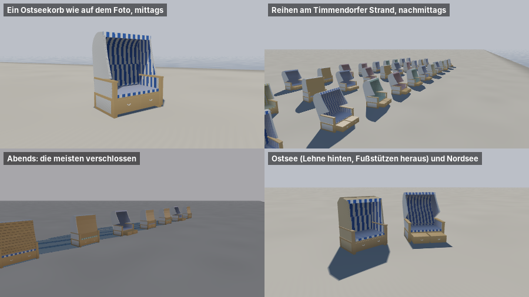

# com.dan.beachchair – Strandkörbe



Der Strandkorb als Element-Package, entstanden für Timmendorf nach dem Foto `Strandkorb.jpg`. Er ist ein Zweisitzer aus Korbgeflecht mit Haube, Seitenwänden und Armlehnen aus Holz. Unten sitzt ein Unterkasten mit zwei Fußstützen zum Herausziehen, der Bezug ist aus gestreiftem Markisenstoff. Es gibt den Ostseekorb mit runder Haube (Timmendorf, Lübecker Bucht) und den Nordseekorb mit eckiger Haube (Sylt). Der Kern braucht nur Java 21, `gl/` zusätzlich JOGL, `demo/` zusätzlich `FStyle.jar`.

Zum Herauskopieren reicht `src/com/dan/beachchair/`.

## Was es kann

- **Netz ohne Grafikkarte** in drei Detailstufen: `mesh(Lod.NEAR)` mit Griffen aus Tau, Rahmen und Rückenpolster (454 Dreiecke), `MID` (226) und `FAR` (78). Die Rundung der Haube folgt der Qualitätsstufe.
- **Teile mit eigenem Baustoff**: Geflecht, Holz, Markisenstoff, Polster, Tau und der Verschluss aus Latten. Jede Ecke trägt Musterkoordinaten in Metern. Die Streifen laufen dadurch wie auf dem Foto über die Haube nach hinten und am Rücken hinunter.
- **Stellung je Korb**: Die Rückenlehne kippt das ganze Oberteil um das Gelenk hinten auf dem Unterkasten (bis 32°), die Fußstützen gleiten bis 42 cm heraus. Abends sind die Körbe verschlossen. `pose(chair, open, lounge)` verteilt das nach dem Tag, `posed(mesh, chair)` rechnet es auf der Prozessorseite nach.
- **Farben aus einer Palette** mit Gewichten. In Timmendorf sind 62 % blau-weiß, dazu kommen dunkelblau, grün, rot und gelb.
- **Blickrichtung**: `facing(seeDeg, windFromDeg, windSpeed, id)` dreht die Körbe zur See. Ab 8 m/s drehen die Gäste sie mit dem Rücken in den Wind, höchstens 60° weg von der See.
- **Darstellung** (`gl/BeachChairGl`): Alle Körbe einer Stufe kommen in einem Aufruf, nah, mittel und fern nach dem Abstand vom Auge. Stellung und Farbe stehen je Instanz. Im Korb ist es dunkler, und Sonne kommt nur durch die Öffnung herein. Jeder nahe Korb wirft einen Schatten auf den Sand (Umriss mit der Sonne geworfen, weicher Rand). Erdkrümmung wie das Gelände der Szene.
- **Offene Werte, Presets, seed**: `ostsee()`, `timmendorf()`, `nordsee()`, `sylt()`. Alle Maße und Farben sind öffentliche Felder. Gleicher `seed` ergibt gleiche Farben und Stellungen.

## Benutzung

```java
BeachChair korb = BeachChair.timmendorf();
korb.quality = BeachChair.Quality.HIGH;
List<BeachChair.Chair> koerbe = new ArrayList<>();
for (Platz p : plaetze) {
    BeachChair.Chair c = korb.chair(p.x(), p.y(), p.z(), p.blick(), p.kennzahl());
    korb.pose(c, 0.9, 0.5);            // 90 % offen, Gäste machen es sich halb bequem
    koerbe.add(c);
}

BeachChairGl gl = new BeachChairGl();
gl.init(gl4, korb);
gl.setChairs(koerbe);
// je Bild, nach dem Gelände:
gl.drawShadows(gl4, view, licht, gelaende::hoehe);
gl.draw(gl4, view, licht);
// Stellungen geändert (abends zu):
for (BeachChair.Chair c : koerbe) korb.pose(c, 0, 0);
gl.touch();
```

Das Licht kommt als Zahlen (`BeachChairGl.Light`): Richtung und Farbe von Sonne und Mond, Himmel oben und am Horizont, Dunst. Alles ist linear und vorbelichtet wie in den übrigen Packages. Mit `display > 0` kommt das Bild gleich fertig für den Bildschirm (für die Vorführung).

## Aufbau

| Klasse | Aufgabe |
|---|---|
| `BeachChair` | Kern: Maße, Bauarten, Presets, Netz in drei Stufen, Stellung, Palette, Blickrichtung, Umriss für den Schatten |
| `gl/BeachChairGl` | Darstellung mit Instanzen je Stufe, Schatten, Bühne für die Vorführung; Shader `beachchair.vert/frag`, `shadow.vert/frag`, `stage.vert/frag` |
| `demo/BeachChairDemo` | Fenster mit Reglern für Lehne, Fußstützen und Sonne; `--bild datei.png [breite]` schreibt das Blatt oben |
| `demo/BeachChairCheck` | Prüfung ohne Fenster, endet mit „Alles in Ordnung.“ |

## Maße

Die Maße sind nach dem Foto und gängigen Zweisitzern gestaltet [G]:

| | Ostsee | Nordsee |
|---|---|---|
| Breite, Tiefe, Höhe | 1,24 × 0,80 × 1,60 m | 1,20 × 0,82 × 1,58 m |
| Sitz, Armlehne | 0,42 m, 0,66 m | 0,42 m, 0,66 m |
| Haube | Viertelellipse 0,34 × 0,36 m | Fase 0,20 × 0,16 m |
| Streifen | 6,5 cm | 9 cm |
| Geflecht, Holz | weiß, Honig | natur, dunkler |

## Demo und Selbsttest

- `java -cp "lib/Renderer.jar;lib/*" com.dan.beachchair.demo.BeachChairDemo` zeigt die Körbe. Tasten: 1 ein Korb, 2 Reihen, 3 abends, 4 Ostsee und Nordsee.
- `… BeachChairDemo --bild docs/img/beachchair.png 900` schreibt das Blatt oben (hier mit Mesa ohne Grafikkarte gerechnet).
- `… com.dan.beachchair.demo.BeachChairCheck` prüft Maße, Stufen, Sitz, Stellung, Verschluss, Palette, seed, Blickrichtung und Umriss.

## Grenzen

- Der Schatten im Korb ist eine Näherung: Er prüft nur, ob der Strahl zur Sonne vorn durch die Öffnung geht.
- Der Schatten auf dem Sand ist die konvexe Hülle des Umrisses. Die Öffnung vorn wirft deshalb keinen Lichtfleck, und Schatten zweier Körbe dunkeln doppelt, wo sie sich überdecken.
- Die Körbe werfen keinen Schatten auf andere Körbe und auf Menschen.
- Klapptische, Nummernschilder und Markisen an der Seite gibt es nicht.
