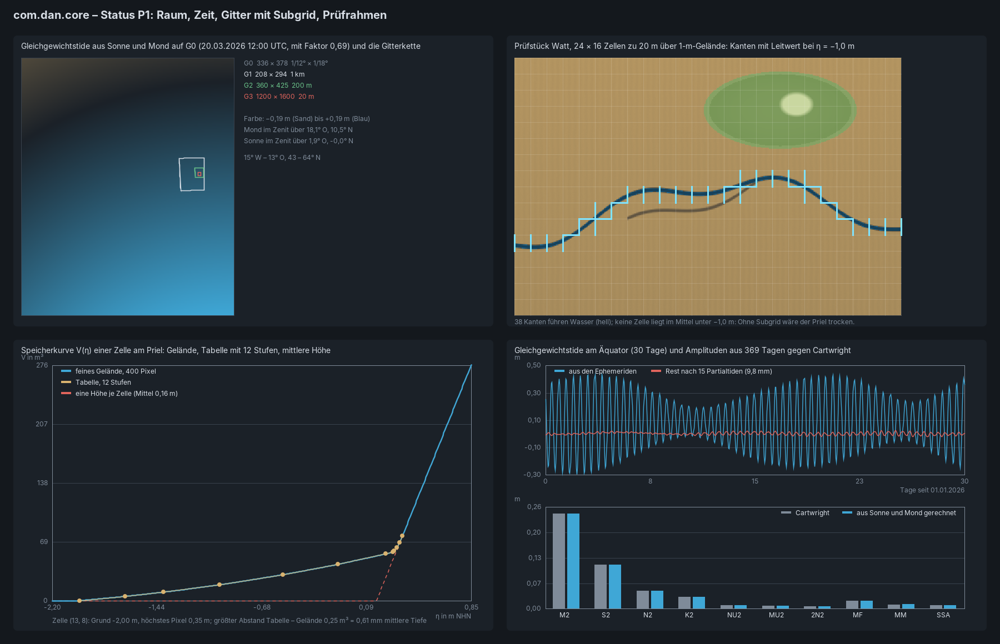

# com.dan.core – der Kern des Renderers

Der Kern ist die unterste Schicht für Physik und Grafik, die miteinander rechnen: ein gemeinsamer Raum, eine gemeinsame Zeit, Felder mit festem Namen und fester Einheit, Gitter mit Subgrid, ein Bus, über den Module sprechen, ein Takt, ein Archiv, Bilanzen und ein Prüfrahmen. Er braucht nur Java 21 (`java.*`).

Grundlage ist das Werkbuch HalligHooge, Teil A, Abschnitte 4 und 5. Hooge ist der Prüfstand; nichts im Kern ist für Hooge gebaut.



## Schichtenvertrag

```
com.dan.core           nur java.*                            dieses Package
com.dan.core.gpu       core + LWJGL (Vulkan, VMA, shaderc)   Gerät, Speicher, Kernel, Ablauf (gpu/README.md)
com.dan.core.szene     nur java.*                            die gemeinsame Szene der Bildmodule und der Referenz (szene/README.md, seit P7a)
com.dan.physics.<m>    core; core.gpu nur in <m>/gpu/        je Modul; kennt kein anderes Physikmodul
com.dan.render.<m>     core + core.gpu                       je Modul; kennt kein Physikmodul, nur Felder
com.dan.aufbereitung   core (ohne gpu)                       Werkzeug: backt Gebiete aus Quellen (aufbereitung/README.md)
```

- **Nur nach unten.** Ein Modul importiert nur Schichten unter sich. Module derselben Schicht kennen einander nicht.
- **Über Felder.** Ein Modul liest und schreibt nur Felder aus dem Katalog. Name, Einheit und Ort im Gitter sind Vertrag.
- **Ein Schreiber.** Jedes Feld hat im Lauf genau einen Schreiber und beliebig viele Leser. Tragen zwei Module zu einem Feld bei (`bed.dz`, `surf.z0`), schreibt jedes seinen Beitrag unter eigenem Namen (`bed.dz.sediment`), und der Kern bildet das Feld daraus.
- **Prüfung im Bau.** `ant check-packages` (`tools/PaketPruefung.java`) übersetzt jede Schicht gegen die Klassen der Schichten darunter, prüft die Importe und die Pfade der Shader (auch hinter `#include`) und vergleicht jede Zeichenkette in `physics` und `render`, die wie ein Feldname aussieht, mit dem Katalog.

Die Element-Packages (`sky`, `tide`, `wave` …) behalten ihren Paketvertrag, bis sie umgebaut werden.

## Aufbau

| Package | Klassen | Aufgabe |
|---|---|---|
| `raum` | `Erde`, `Utm`, `Ebene` | GRS80 und Kugel, Schwere, Coriolis, Erdkrümmung mit Refraktion; UTM nach Krüger/Karney mit Konvergenz und Maßstab; die Ebene der Szene (x = Ost − Ost₀, y = Höhe NHN, z = Nord₀ − Nord), Lage relativ zum Auge |
| `zeit` | `Zeit`, `Uhr` | UTC, TT, julianisches Datum; Szenenzeit = Start + Zeitraffer · Laufzeit |
| `astro` | `Gestirne`, `Partialtide`, `FSun`, `FMoonPosition`, `FAstroTime`, `FAngle` | Sonne und Mond (VSOP87, ELP nach Meeus), Gezeitenpotential zweiten und dritten Grades, Sonnenstand (`sun.dir`, `sun.E`); 22 Partialtiden mit Doodson-Zahlen und Knotenfaktoren |
| `feld` | `Feld`, `Katalog`, `Eintrag`, `Ort` | die 48 Felder der Grundstufe (44 und vier Beiträge; Stand P10c); Werte in double (Referenz) oder float (Betrieb); Abgleich mit der Karte ausdrücklich |
| `gitter` | `Gitter`, `Subgrid`, `Umrechnung`, `Gelaende`, `Gebiet`, `Gradraster`, `Tidenfeld`, `Wetterfeld`, `Ueberflutung` | Rechteckgitter geographisch oder in UTM, Schachteln; Tabellen V(η), A(η), K(η) aus dem feinen Gelände; Mengen erhalten, Zustände bilinear; das Feingelände als Kachelstapel (seit P3); seit P5b Felder aus Quellen auf Rastern in Länge und Breite (bilinear über gültige Punkte): harmonische Konstanten (EOT20) und stündliches Wetter (ERA5); seit P13b die Statistik der Überflutung je Zelle (MThw, MSpThw, MNpThw, Dauer, Anteil der Tiden mit Wasser; `ueberflutung.txt` und `.f32`) |
| `bus` | `Bus`, `Modul`, `Anmeldung`, `Verbund` | Anmelden, Verdrahten, Schreiben mit Zeitstempel, Lesen zu einer Zeit t; ein Feld auf mehreren Gittern, Antrieb im Intervall (seit P5c); `Verbund` bildet ein Feld aus Beiträgen (Summe oder Maximum) |
| `takt` | `Takt` | Reihenfolge der Module, eigener Faden, Zeitraffer |
| `archiv` | `Archiv` | Läufe als Dateien (float16 oder float32), vorwärts und rückwärts abspielbar; seit W5b `wert(spur, stand, zelle)` (ein Wert ohne den Satz) und `Archiv.messung()` (je Faden: Lesen, Warten auf die Sperre, langsamster Satz); seit W5c `vorlesen(k)`, `vorgelesen(k)`, `standBis(t)` und eine nachgestellte Platte für Prüfungen (`platteSimulieren`); seit D1 (Werkbuch HalligHooge 162) **gepackte Spuren**: `Packung` (`<feld>.f16z`/`.f32z`, Deflate in Blöcken zu 64 KB, verlustfrei, je Stand CRC32C des Originals; Kopf `spur.… ;Z`), `Packer` (Lauf oder Archiv von Ordner zu Ordner, lässt Spuren weg, prüft jeden Stand; `--von --nach`, `--pruefen`); der Vorleser entpackt in einen Vorrat im Prozess (`-Darchiv.vorrat.mb`, Vorgabe 192), `vorausPlatz()`, `bezug(k)` |
| `bilanz` | `Bilanz`, `Bilanzfehler` | Bestand und Posten; ein Rest über dem Grenzwert ist ein Fehler |
| `pruef` | `Attest`, `Harmonik`, `Statistik`, `Bildvergleich`, `Pegel` | Prüfsteine mit Grenzwert, harmonische Analyse mit Rayleigh-Kriterium (seit P5d auch vieler Orte mit denselben Zeiten: `Harmonik.Sammler`), RMSE, Bias, Skill nach Willmott, Feldvergleich, ΔE₀₀; seit P5b Pegel als Maßstab (Reihe in m NHN, Kennwerte, Analyse, Vorhersage) |
| `demo` | `CoreCheck`, `CoreBild`, `Probe` | Prüfung ohne Fenster, Status-Bild, Prüfstücke |

## Benutzung

Ein Modul meldet an, was es liest und schreibt, und rechnet ein Kopplungsintervall:

```java
final class Hydro implements Modul {
    public String name() { return "hydro"; }

    public void anmelden(Anmeldung a) {
        a.kopplung(20)                                                    // Sekunden Modellzeit
         .liest("tide.bc", "m, m²/s", Ort.RAND, g3)
         .schreibt("water.eta", "m NHN", Ort.ZELLE, g3, Feld.Zahl.FLOAT);
    }

    public void beginn(double t0, Bus bus) { /* Anfangsstand füllen */ bus.lege(this, "water.eta", t0); }

    public void schritt(double t0, double t1, Bus bus) {
        bus.lies(this, "tide.bc", t0, rand);                              // die anderen zur Startzeit
        Feld eta = bus.schreibfeld(this, "water.eta");
        /* eigene Schritte nach CFL von t0 bis t1 */
        bus.lege(this, "water.eta", t1);
    }
}
```

```java
Bus bus = new Bus(Katalog.grundstufe());
bus.anmelden(tide).anmelden(hydro).anmelden(bild);
bus.verdrahten();                       // prüft Name, Einheit, Ort, Gitter, Schreiber; bei Mängeln startet nichts
Takt takt = new Takt(bus);
takt.beginn(0);
takt.ziel = 48;                         // gewünschter Zeitraffer
takt.laufen(uhr);                       // Physik im eigenen Faden, der Uhr voraus
// je Bild:
double t = takt.fuehre(uhr, laufzeit);  // hält das Ziel, wenn die Physik es schafft; die Uhr läuft ihr nie davon
bus.lies(bild, "water.eta", t, eta);    // zwischen zwei Ständen interpoliert
```

Subgrid aus einem feinen Gelände (1 m unter Zellen von 20 m):

```java
Subgrid s = Subgrid.bauen(g3, 20, gelaende);          // gelaende: Subgrid.Feingelaende, liest Fenster von Pixeln
double v = s.volumen(zelle, eta);                     // m³, an den Stufen genau das Volumen des feinen Geländes
double h = s.eta(zelle, v);                           // Umkehrung
double k = s.leitwert(s.kanteX(i, j), eta);           // m³/s, Durchfluss = K · √Gefälle
s.neu(i0, j0, i1, j1);                                // neu backen, wo sich der Boden geändert hat
```

## Was der Kern festlegt

- **Zellen** zählen von Südwest: i nach Osten, j nach Norden, `index = i + nx · j`. Das Gitter ist versetzt: Wasserstand in der Zelle, Durchfluss auf der Kante.
- **Höhen** in m NHN, nach oben positiv. Grund `b`, Wasserstand `η`, Tiefe `h = η − b`.
- **Modellzeit** `t` sind Sekunden seit dem Start der Szene (`Uhr`).
- **Lesen am Bus:** Zustände linear zwischen den beiden Ständen um t; Flüsse als Zeitmittel des Kopplungsintervalls, in dem t liegt. Der Bus hält je Feld drei Stände: Die Physik rechnet ein Intervall voraus, während das Bild noch im vorigen liest.
- **Mehrere Gitter je Feld (seit P5c):** Ein Schreiber darf ein Feld auf mehreren Gittern ablegen (`schreibfeld(m, name, gitter)`, `lege(m, name, gitter, t)`); je Gitter eine Leitung mit eigenen Ständen, „ein Schreiber“ gilt weiter je Feld. Ein Leser bekommt das gleiche Gitter, sonst das einzige, sonst das feinste, das seines ganz deckt (umgerechnet). Liest ein Modul dasselbe Feld auf mehreren Gittern, gilt das Gitter des Zielfelds (`lesefeld(m, name, gitter)`).
- **Antrieb im Intervall (seit P5c):** `Anmeldung.liestImIntervall` – das Modul liest das Feld zu jeder Zeit seines Intervalls (Randwerte, Wind). Der Takt lässt den Schreiber vorher bis zum Ende dieses Intervalls rechnen, auch wenn er dann nicht am weitesten zurückliegt, und beginnt ihn vor dem Leser; die Leitung hält so viele Stände, wie das Intervall des Lesers Intervalle des Schreibers überdeckt. Ein Kreis solcher Antriebe ist ein Mangel.
- **Takt:** Es rechnet immer das Modul, das am weitesten zurückliegt, bei Gleichstand das früher angemeldete; liest es einen Antrieb im Intervall, der noch nicht bis zu dessen Ende gerechnet hat, rechnet erst dieser. Die Reihenfolge hängt nicht von der Rechenzeit ab; darum ist ein Lauf reproduzierbar.
- **Feingelände** (`Gelaende`, seit P3): ein Stapel von Höhenkacheln im Format von `clipmap.TileFolder` (`STUFE.txt`, `E<Ost>_N<Nord>.r32`, float32 Little Endian, Zeilen von Nord, NaN = kein Wert). Für eine Abtastung mit Schritt c gilt zuerst die gröbste Stufe, die noch feiner oder gleich c ist, wo sie nichts hat die gröberen, dann die feineren; in einer Stufe bilinear, fehlende Nachbarn zählen nicht, solange die übrigen ein Viertel des Gewichts tragen. An einer Pixelmitte mit dem Schritt der Stufe ist der Wert genau der der Kachel. `feingelaende(gitter, fein)` gibt das Gelände unter einem Gitter in UTM für `Subgrid.bauen`; so backen alle Gitter aus demselben Stapel, und das Bild liest ihn auch. Seit P6e trägt `mitMindesthoehe(stufe)` die Mindesthöhe der Bauwerke in den Stapel: bei Abtastungen bis zu ihrer Zelle ist jeder Wert mindestens der des Pixels, in dem der Ort liegt (wie `mindestens` beim Backen); `Gebiet.mindesthoehe(ordner)` findet sie (die des feinsten Gitters in UTM, das eine hat). So liest das Bild die Deiche so hoch, wie hydro sie rechnet. Seit P7c gibt `abfrage()` eine Abfrage mit eigenem Speicher der Kacheln je Faden (für die Referenz, dieselbe Regel).
- **Gebiet** (`Gebiet`, seit P3d): die Leseseite eines aufbereiteten Gebiets (Gitterkette, `ground.z`, Packungen, Bauwerke, Rezept aus `gebiet.txt`). Seit P4d backt `auge(ost, nord)` G4 im Lauf aus dem Stapel (Zelle, Größe und Feinpixel aus dem Rezept; Südwestecke auf Zellen von G3), mit der Mindesthöhe von G3 und der Rauheit nach den Klassen (`Gelaende.mindestens`, `Gelaende.rauheit`, `Gelaende.manning` – dieselben Regeln, nach denen die Aufbereitung G3 backt; G4 aus dem Lauf ist bitgleich mit G4 aus der Aufbereitung). `vorgabe()` liest die Vorgabe der Tide am Rand (`vorgabe.txt`).
- **Subgrid:** 12 Stufen je Tabelle [G]. Der Fehler von V zwischen zwei Stufen ist höchstens Zellfläche · Spanne / (4 · 11²), also 0,21 %. Die Kante trägt die wirksame Tiefe h_K = (K / Σ Δs/n)^(3/5); K = Σ Δs/n · h_K^(5/3). Seit P4 (F25) trägt die Kante dazu die mittlere benetzte Tiefe h_A = Σ max(0, η − z) / fein; der Querschnitt ist Kantenlänge · h_A. Die Packung (`HHSUBGR2`, float16, 244 Byte je Zelle) hat je Kante drei Tabellen (Stufe, h_K, h_A); die Stufen werden gemeinsam nach dem Fehler beider gewählt. Am Prüfstück liegt der Leitwert ab 1 cm wirksamer Tiefe höchstens 3,3 % neben der Summe über die Pixel, im Mittel 0,2 %; der Querschnitt zwischen den Stufen höchstens 2,4 %. Packungen der Version 1 (`HHSUBGR1`, ohne h_A) bleiben lesbar; hydro verlangt Version 2. `Packung.fenster` schneidet ein Fenster aus der Packung eines Gitters (bitgleich mit dem Backen des Fensters; seit P5d im Kern, vorher in `HydroCheck`).

## Demo und Selbsttest

```bash
java -cp "build/classes" com.dan.core.demo.CoreCheck
```

`CoreCheck` prüft 116 Prüfsteine in sechzehn Teilen (seit P5c; Teil 16: ein Feld auf mehreren Gittern, Antrieb im Intervall, Folge des Rands; seit P5d in Teil 12 `Harmonik.Sammler` gegen je eine Analyse und aus parallelen Aufrufen) ohne Fenster und ohne Grafikkarte, endet mit „Alles in Ordnung.“ und schreibt das Attest nach `docs/status/P1_CoreCheck.md`. Vergleichswerte von außen: PROJ 9 (UTM), astropy 8.0 (Sonnen- und Mondstand), Meeus (Beispiele 25.b und 47.a), Cartwright (Gleichgewichtstide), Schureman (Knotenfaktoren), Sharma u. a. (ΔE₀₀).

```bash
java -cp "build/classes" com.dan.core.demo.CoreBild
```

`CoreBild` schreibt das Status-Bild nach `docs/status/P1_Core.png`.

## Grenzen

- **Weltzeit:** UT1 − UTC (unter 0,9 s) bleibt unberücksichtigt; das sind höchstens 0,004° im Stundenwinkel.
- **Sonnenstand** ohne Refraktion; die rechnet `atmos`.
- **Gezeitenpotential** bis zum dritten Grad; der Faktor der festen Erde (0,69) wird vom Modul angewandt, nicht vom Kern.
- **Ebene der Szene** ist die Gitterebene von UTM: Strecken sind bei Hooge um 0,039 % kürzer als in der Natur (9 m auf 24 km).
- **Subgrid:** Ein Damm im Inneren einer Zelle wird nicht gesehen. Die Tabellen in double brauchen 688 Byte je Zelle; große Gitter werden streifenweise gebacken und gepackt.
- **Umrechnung** dreht keine Vektoren; zwischen geographischem Gitter und UTM dreht das Modul sie um die Meridiankonvergenz.
- **Bus:** Er rechnet nur Zustände in Zellen auf ein anderes Gitter um. Flüsse, Kanten und Ränder rechnet das Modul selbst um.
- **Archiv:** Ein Leser je geöffnetem Lauf. Der Katalog der Läufe in Oracle (F16) gehört zu Teil B.
- **Karte:** `Feld.Kartenseite` ist nur die Schnittstelle; [`core.gpu`](gpu/README.md) stellt sie.
- **Verbund:** Das gebildete Feld folgt seinen Beiträgen um ein Kopplungsintervall.

## Entschieden

- **F18 (A):** Jeder Schreiber legt seinen Teil unter eigenem Namen ab, der Kern bildet das Feld: `bed.dz` ist die Summe aus `bed.dz.sediment` und `bed.dz.aeolian`, `surf.z0` das Maximum aus `surf.z0.sediment` und `surf.z0.vegetation`.

```java
bus.anmelden(new Verbund(katalog, "bed.dz", g3, Feld.Zahl.FLOAT, 600, "sediment", "aeolian"));   // Modul „core.verbund.bed.dz“
```

- **F19 (A):** G4 hat 1000² Zellen zu 2 m, genau 2 × 2 km; es liegt auf ganzen Zellen von G3 (Verhältnis 10).

## Quellen

- Karney, C. F. F. (2011): Transverse Mercator with an accuracy of a few nanometers. J. Geodesy 85.
- Meeus, J. (1998): Astronomical Algorithms, 2. Auflage (Kap. 12, 22, 25, 47).
- Doodson, A. T. (1921): The harmonic development of the tide-generating potential. · Cartwright, D. E., Edden, A. C. (1973): Corrected tables of tidal harmonics. · Schureman, P. (1958): Manual of harmonic analysis and prediction of tides. · Pugh, D. T. (1987): Tides, Surges and Mean Sea-Level.
- Casulli, V. (2009): A high-resolution wetting and drying algorithm for free-surface hydrodynamics. · Volp, N. D., van Prooijen, B. C., Stelling, G. S. (2013). · Sehili, A., Lang, G., Lippert, C. (2014).
- Willmott, C. J. (1981): On the validation of models. Physical Geography 2.
- Sharma, G., Wu, W., Dalal, E. N. (2005): The CIEDE2000 color-difference formula. Color Research & Application 30.
