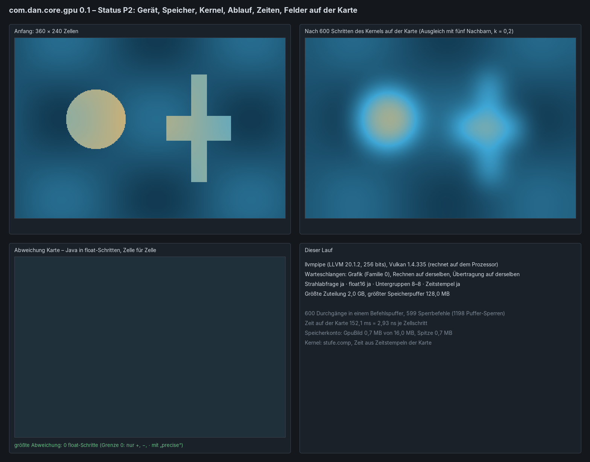

# com.dan.core.gpu – der Kern auf der Grafikkarte

`core.gpu` ist die zweite Schicht des Kerns: Gerät, Speicher, Kernels, Abläufe mit Sperren, Zeitleisten, Zeiten und die Seite der Felder auf der Karte. Darauf rechnen die Physikmodule (`physics.<m>.gpu`) und zeichnen die Bildmodule (`render.<m>`). Die Schicht braucht `com.dan.core` und LWJGL 3.4.3 (Vulkan 1.3, VMA, shaderc) aus `lib/lwjgl/`.

Grundlage ist das Werkbuch HalligHooge, Teil A, Abschnitt 6. Aus P0 stammen die Entscheidungen: Vulkan über LWJGL (F9: JDK 21, Speicher außerhalb des Heaps über `MemoryUtil`), Shader in GLSL mit shaderc (F10), Grenze A für den Vergleich von Kernels.



## Aufbau

| Klasse | Aufgabe |
|---|---|
| `Geraet` | Instanz, Gerät, Warteschlangen für Grafik, Rechnen und Übertragung, Fähigkeiten (`kann`), Heaps, Speicherkonten, Validierung |
| `Schlange` | eine Warteschlange: Befehlspuffer je Faden, Abschicken mit Zeitleiste, `einmal` (abschicken und warten) |
| `Zeitleiste` | Zeitleisten-Semaphore: die Ordnung zwischen Rechnen und Bild, ohne dass ein Faden wartet |
| `Konto` | Speicherbudget eines Moduls; eine Zuteilung über die Grenze wird abgelehnt |
| `Puffer` | Puffer über VMA in drei Arten: `KARTE`, `GETEILT` (vom Prozessor sichtbar), `WIRT` (Zwischenpuffer) |
| `Bild` | 2D-Bild (`R32F`, `R16F`, `RG16F`, `RGBA16F`, `RGBA32F`, `RGBA8`, `RGBA8S` in sRGB, Tiefe `D32F`) zum Speichern, Zeichnen, Abtasten, Hochladen und Lesen; die Nutzung folgt aus dem, was das Gerät für das Format kann (seit P6a) |
| `Abtaster` | wie ein Shader ein Bild als Textur liest: Filter, Rand; `an(bild)` belegt eine Bindung `TEXTUR` (seit P6a) |
| `Zeichner` | Raster-Pipeline aus Scheitel- und Bildpunkt-Shader mit dynamischem Rendern, ohne Scheitel-Eingänge (Daten über `gl_VertexIndex` aus Puffern), Satz 0 und Feldtafel wie ein Kernel, Tiefe umgekehrt (seit P6a) |
| `Flaeche` | Vulkan-Fläche in einem AWT-Canvas über JAWT (Win32, unter Linux Xlib), Swapchain, Neuaufbau bei neuer Größe, höchstens zwei Bilder unterwegs (seit P6a); seit W3 mit `TRANSFER_SRC`, wenn die Fläche es kann (Merken für die Blende; `Bild.fremd(…, nutzung)`) |
| `Auflage` | etwas über dem fertigen Bild, nach der Filmkurve (seit P11c2; render.analysis) |
| `Bildziel`, `Bildteil` | HDR-Bild, Tiefe, Blick, Zeit, Vorbelichtung und geteilte Bilder; ein Teil des Bilds, den render.frame je Bild ausführt (seit P6a) |
| `Shader` | GLSL nach SPIR-V; `#include "/com/dan/…"` aus dem Klassenpfad; vorgebaut oder zur Laufzeit; Shader des Bestands (GLSL 430) nach Vulkan |
| `Kernel` | Rechen-Pipeline aus SPIR-V mit Push-Konstanten; Satz 0 feste Bindungen (Puffer, Speicherbild, Textur, Beschleunigungsstruktur), Satz 1 die Feldtafel |
| `Feldtafel` | bindlos: bis 1024 Puffer unter einer Nummer; der Kernel wählt Felder über Push-Konstanten |
| `Ablauf` | Durchgänge mit gemeldeten Zugriffen; der Ablauf rechnet die Sperren (Barrieren) und Übergänge selbst; seit P6a auch Zeichnen (`zeichne`), Texturen (`textur`) und das Bild der Swapchain (`zeigen`) |
| `Stoppuhr` | Zeit auf der Karte je Abschnitt aus Zeitstempeln, ohne im Lauf zu warten |
| `Karte`, `KartenFeld` | die Seite eines `Feld` auf der Karte: `hoch()`, `herunter()`, Kernels rechnen auf `puffer` |
| `Mittel` | was Durchgänge lesen und schreiben: `Puffer` oder `Bild`, mit dem Stand des letzten Zugriffs |
| `demo` | `GpuCheck` (Prüfung ohne Fenster), `GpuBild` (Status-Bild), Prüfkernels |

## Benutzung

Ein Kernel, zwei Puffer, ein Ablauf:

```java
try (Geraet g = new Geraet()) {
    Konto konto = g.konto("hydro", 512L << 20);                          // Budget des Moduls
    try (Kernel k = Kernel.lade(g, "/com/dan/physics/hydro/gpu/fluss.comp", 12, null, Kernel.Bindung.PUFFER, Kernel.Bindung.PUFFER);
         Puffer a = Puffer.speicher(g, konto, "eta", 4L * n); Puffer b = Puffer.speicher(g, konto, "eta neu", 4L * n);
         MemoryStack s = stackPush()) {
        a.schreibe(werte);
        ByteBuffer push = s.malloc(12).putInt(0, nx).putInt(4, ny).putFloat(8, dt);
        Ablauf ab = new Ablauf(g)                                        // liest a, schreibt b – die Sperren rechnet der Ablauf
                .rechne("fluss", k, k.satz(a, b), push, Kernel.gruppen(n, 64), 1, 1, new Mittel[] {a}, new Mittel[] {b});
        g.rechnen.einmal(c -> ab.aufnehmen(c, null));                    // abschicken und warten
        float[] neu = b.floats(n);
    }
}
```

Physik und Bild nebeneinander: Die Physik schickt ab, ohne zu warten; das Bild wartet auf der Karte.

```java
Zeitleiste physik = new Zeitleiste(g);
VkCommandBuffer c = g.rechnen.befehle();
ablauf.aufnehmen(c, uhr);
long stand = g.rechnen.schicke(c, physik, null, 0);                      // signalisiert „stand“, wenn fertig

VkCommandBuffer b = g.grafik.befehle();
bild.aufnehmen(b, null);                                                 // new Ablauf(g, g.grafik)
g.grafik.schicke(b, bildLeiste, physik, stand);                          // wartet auf der Karte auf die Physik
```

Ein Feld vom Bus auf der Karte:

```java
Karte karte = new Karte(g, konto);
Feld feld = bus.schreibfeld(this, "water.eta");
KartenFeld kf = karte.an(feld);                                          // beim zweiten Mal dieselbe Seite
/* Kernels rechnen auf kf.puffer */
kf.geschrieben(feld, physik, stand);                                     // die Karte hat den neueren Stand
feld.herunter();                                                         // nur wenn ein Leser auf dem Prozessor ihn braucht
bus.lege(this, "water.eta", t1);
```

Shader des Bestands (OpenGL, lose Uniforms) laufen ohne Änderung der Quelle:

```java
Shader.Bestand f = Shader.bestand("/com/dan/wave/gl/bay_flux.comp");     // Uniforms werden Push-Konstanten
Kernel k = new Kernel(g, "bay_flux", f.spirv().code, f.gl().groesse, null, PUFFER, PUFFER, PUFFER, PUFFER);
ByteBuffer push = f.gl().packen(stack, "nx", nx, "nz", nz, "mode", 0, "g", 9.81f);
```

### Geteiltes für die Bildmodule (seit P6c)

- `Bildziel.geteilt` (Bilder), `Bildziel.puffer` (Puffer) und `Bildziel.werte` (Zahlen auf dem Prozessor): ein Schreiber legt beim Vorbereiten ab, Leser holen mit `geteilt(name)`, `puffer(name)`, `werte(name)`; ein fehlender Name wirft.
- `luft.glsl`: die Atmosphäre für alle Bildmodule (Tabellen lesen, Strahlengang, Himmelsansicht, `Himmelswerte`), Zeile für Zeile wie `core.szene.Scattering`; seit P7e erste Streuung genau, ab der zweiten J aus `core.szene.Streuordnungen` (`jAus`, 32 `texelFetch`, dieselbe Abbildung wie Java), Beiwerte der Wellenlängen als Argument; die Tabelle der Durchlässigkeit trägt die optische Tiefe (`durchlaessigkeit()` gibt e^−τ). render.air rechnet und legt ab; Gelände und Wasser lesen.

## Was core.gpu festlegt

- **Warteschlangen.** `g.grafik` kann alles. `g.rechnen` und `g.uebertragung` sind eigene Warteschlangen, wenn das Gerät sie hat (680M: ja), sonst dieselbe. Puffer und Bilder gehören dann allen Familien gemeinsam; Übergaben zwischen Familien gibt es nicht.
- **Sperren.** Ein Durchgang meldet, was er liest und schreibt. Lesen nach Lesen braucht keine Sperre; alles andere bekommt eine, nur für das betroffene Betriebsmittel. Der Stand liegt am Betriebsmittel, je Warteschlange für sich, und gilt in der Reihenfolge der Aufnahme.
- **Zwischen zwei Warteschlangen** trennt eine `Zeitleiste`, keine Sperre. Eine Zeitleiste wird von einer Warteschlange signalisiert. Sie darf geschlossen werden, sobald ihre Arbeit fertig ist; die Warteschlange gibt ihre Befehlspuffer über eine eigene Zeitleiste frei und hängt nicht an der des Aufrufers.
- **Übertragung.** `schreibe`, `lies`, `floats`, `nullen` warten, bis die Daten da sind. Arbeit, die das Betriebsmittel noch benutzt, muss vorher fertig sein (`Zeitleiste.warte`).
- **Kernels gegen Java.** Ein Kernel, der nur addiert, subtrahiert und multipliziert und seine Rechnung mit `precise` kennzeichnet, liefert dieselben Bits wie Java in float. Division, Wurzel und Funktionen dürfen um wenige Schritte abweichen; für sie gilt Grenze A (nach einem Schritt 1·10⁻⁵ m).
- **Große Felder in Stücken.** Eine Zuteilung ist höchstens `g.groessteZuteilung` groß (680M: 2 GB). `Puffer` lehnt Größeres ab.
- **float16.** Tabellen in float16 (Subgrid) liest jeder Kernel über `unpackHalf2x16`. `kann.float16()` heißt: Rechnen in float16 und `float16_t` im Puffer.
- **SPIR-V.** Das Ant-Ziel `spirv` übersetzt die Shader der Vulkan-Schichten nach `build/classes/…/<name>.spv` und schreibt daneben, aus welchen Quellen (`.spv.von`, SHA-256). `Shader.laden` nimmt das vorgebaute SPIR-V nur, solange Shader und Eingebundenes unverändert sind; sonst übersetzt es zur Laufzeit. So läuft nach dem Speichern in NetBeans nie ein alter Kernel.
- **Fähigkeiten.** `g.kann` nennt Strahlabfrage, float16, Untergruppen, Zeitstempel, eigene Warteschlangen. Ein Modul fragt, bevor es eine davon benutzt.

## Demo und Selbsttest

```bash
java --enable-native-access=ALL-UNNAMED -cp "build/classes;lib/lwjgl/*" com.dan.core.gpu.demo.GpuCheck
```

`GpuCheck` prüft die Schicht in zehn Teilen (Teil 9, seit P6a: Zeichnen gegen eine Rasterung in Java, Textur) ohne Fenster auf der Grafikkarte, endet mit „Alles in Ordnung.“ und schreibt das Attest nach `docs/status/P2_GpuCheck.md`. Was ein Gerät nicht kann, wird genannt und nicht geprüft.

Mit `-Dcore.gpu.validierung=true` prüft die Validierungsschicht des Vulkan SDK mit; ab Schicht 1.4.304 auch die Synchronisation (fehlende Sperren, mit den Zugriffen der Shader). `GpuCheck` macht dann eine Gegenprobe: Zwei Durchgänge ohne gemeldete Zugriffe müssen als Fehler auffallen.

```bash
java --enable-native-access=ALL-UNNAMED -cp "build/classes;lib/lwjgl/*" com.dan.core.gpu.demo.GpuBild
```

Mit `-Dcore.gpu.getrennt=true` bekommen Rechnen und Übertragung auch auf einem Gerät mit einer Warteschlange eigene Schlangen (Pools, Zeitleiste, Stand), die auf derselben Warteschlange abschicken. So läuft der Aufbau der 680M auf einem Software-Gerät; für den Betrieb ist das nicht gedacht.

`GpuBild` schreibt das Status-Bild nach `docs/status/P2_Gpu.png`. Den Vergleich der Kernels aus `wave.Bay` macht `com.dan.hallighooge.p2.P2Bay` im Projekt HalligHooge (der Kern kennt keine Element-Packages).

Zeichnen in ein Bild (seit P6a):

```java
Zeichner z = Zeichner.lade(g, "/com/dan/render/frame/voll.vert", "/com/dan/render/frame/ausgabe.frag", 12, null, art, Kernel.Bindung.TEXTUR, Kernel.Bindung.PUFFER);
long satz = z.satz(abtaster.an(hdr), puffer);
new Ablauf(g, g.grafik).zeichne("Ausgabe", new Bild[] {ziel}, null, null, null,           // Farbziel laden, ohne Tiefe
        Ablauf.und(Ablauf.textur(Ablauf.ZEICHNEN, hdr), Ablauf.liest(Ablauf.ZEICHNEN, puffer)),
        c -> z.zeichne(c, satz, push, 3, 1));
```

```bash
java --enable-native-access=ALL-UNNAMED -cp dist\Renderer.jar com.dan.core.gpu.demo.FlaecheCheck
```

`FlaecheCheck` öffnet ein Fenster mit einem Canvas, zeigt 240 Bilder (je eine Farbe), ändert dabei die Größe und schreibt `docs/status/P6_Flaeche.md`.

## Grenzen

- **Fenster** nur über einen AWT-Canvas (JAWT); `Geraet.Optionen.flaeche` schaltet die Erweiterungen ein. `FlaecheCheck` prüft die Fläche unter Xvfb mit lavapipe und unter Windows auf der Karte.
- **Strahlabfrage.** Die Fähigkeit wird eingeschaltet und `Kernel.Bindung.STRAHLEN` bindet eine Beschleunigungsstruktur; gebaut wird sie in P11.
- **Ablauf.** Die Durchgänge laufen in der gemeldeten Reihenfolge; der Ablauf ordnet nicht um und fasst nicht zusammen. Er darf nur in Befehlspuffer seiner Warteschlange aufgenommen werden.
- **Sperren gelten für das ganze Betriebsmittel**, nicht für Teile eines Puffers.
- **Bilder** haben eine Ebene und eine Stufe (keine Mip-Stufen).
- **Zeichner** ohne Scheitel-Eingänge und ohne Mehrfachabtastung; Bildfeld und Schere decken das ganze Ziel.
- **Feldtafel:** 1024 Plätze, nur Puffer mit float oder uint.
- **Stoppuhr:** Ring von vier Runden; eine Runde, die nicht gelesen wird, geht verloren und wird gezählt.
- **Validierung** älter als 1.4.304 kennt das Warten auf Zeitleisten nicht; die Prüfung der Synchronisation bleibt dann aus.
- **Software-Geräte** (lavapipe, SwiftShader) haben nur eine Warteschlange. Der Weg mit eigenen Warteschlangen für Rechnen und Übertragung läuft nur auf einer Karte, die sie hat; geprüft ist er mit `GpuCheck` auf der Radeon 680M. Die Prüfhilfe `core.gpu.getrennt` stellt den Aufbau nach, nicht die zweite Warteschlange selbst.

## Quellen

- Khronos Group: Vulkan 1.3 Specification, Kapitel 7 (Synchronization and Cache Control), 14 (Resource Descriptors), 18 (Queries).
- Khronos Group: SPIR-V 1.6 Specification, Dekoration `NoContraction`; GLSL 4.60, Qualifizierer `precise`.
- LWJGL 3.4.3: Bindungen für Vulkan, Vulkan Memory Allocator 3 (AMD) und shaderc (Google).
- Werkbuch HalligHooge, Teil A, Abschnitte 6 und 12 (P0, P2).
