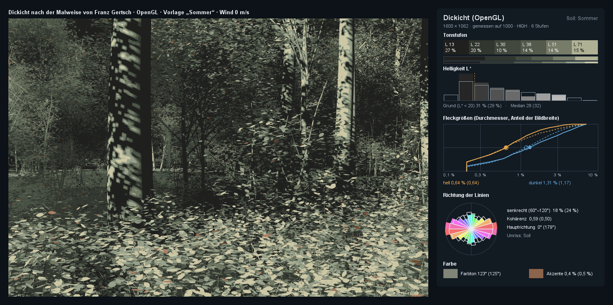
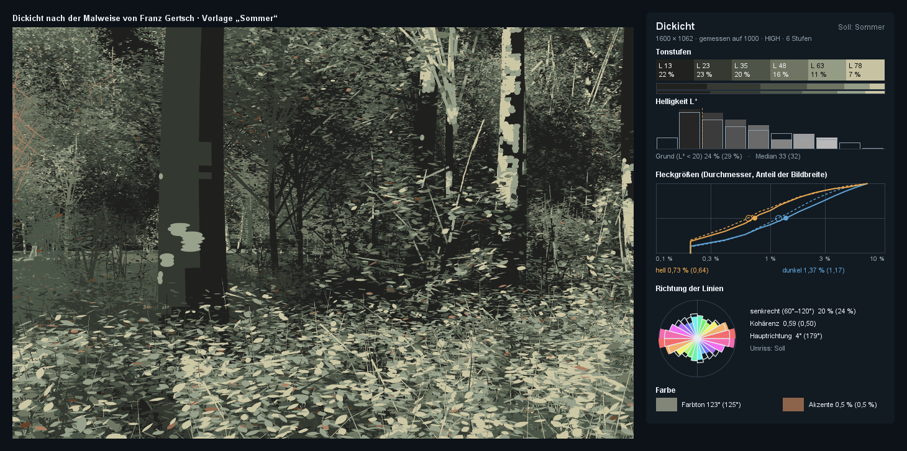
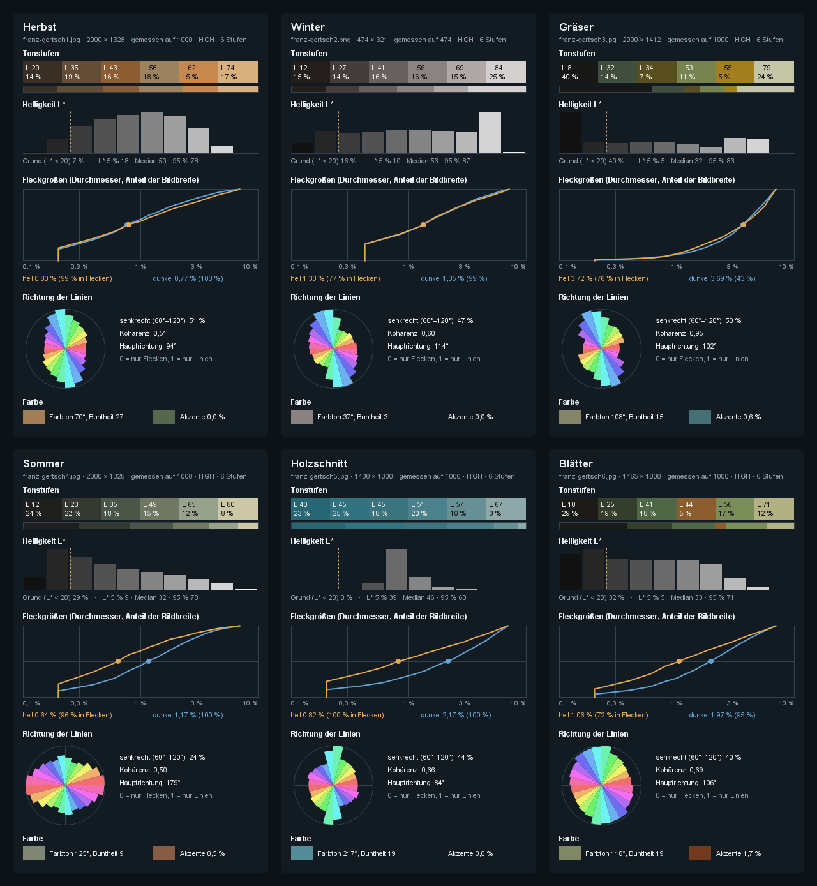
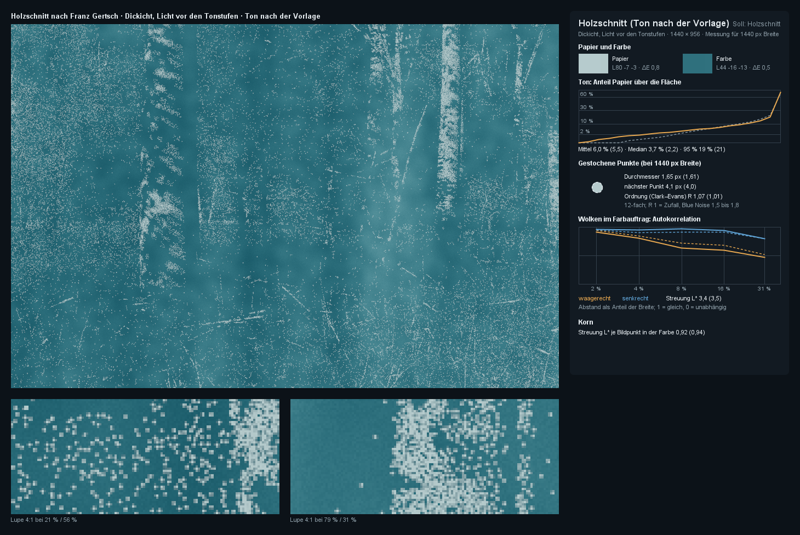
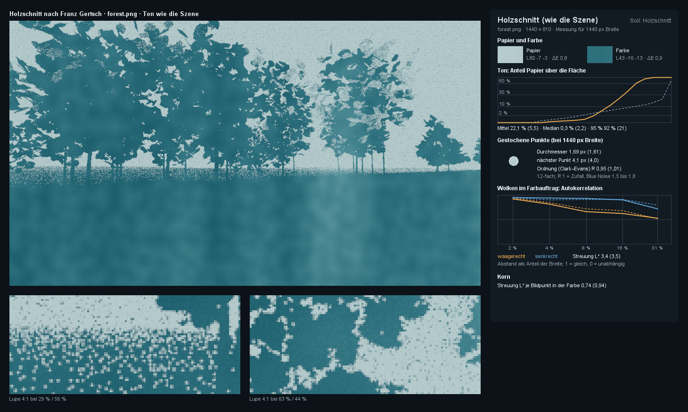
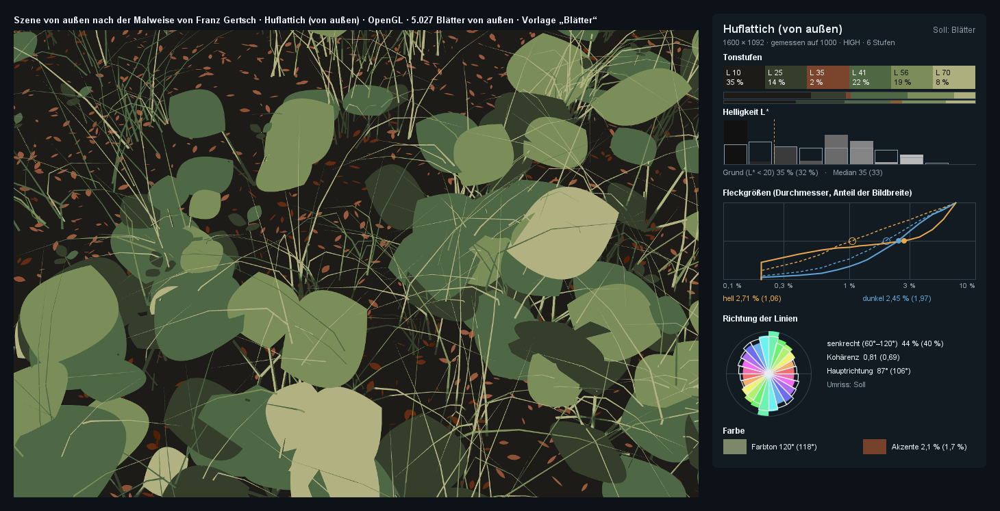

# com.dan.gertsch – Bäume und Gras nach Franz Gertsch (Probe)

**Stand: Phase 5 (08.11.2026).** Ein Probe-Paket. Es soll Bäume und Gras so zeichnen, wie Franz Gertsch (1930–2022) sie gemalt und geschnitten hat:

- jedes Blatt ein flacher Fleck mit harter Kante
- wenige Tonstufen
- ein fast schwarzer Grund
- warme Lichtflecken
- kein Himmel und keine Tiefenschärfe

Bei Gertsch entsteht das Abstrakte aus der Treue zum Foto, nicht aus einem Filter. Darum rechnet das Paket zuerst nach, was die Bilder ausmacht, und vergleicht später jedes gerenderte Bild mit diesen Zahlen.

- **Phase 1** vermisst die Vorlagen und legt die Ergebnisse als Presets ab (`Vorlagen`).
- **Phase 2** malt ein Dickicht auf dem Prozessor nach diesen Regeln und misst das Bild gegen „Sommer“ (Abschnitt [Phase 2](#phase-2-das-dickicht-gemalt)).
- **Phase 3** malt dasselbe Dickicht auf der Grafikkarte, jedes Bild neu und im Wind, mit Hysterese der Tonstufen (Abschnitt [Phase 3](#phase-3-auf-der-grafikkarte-im-wind)).
- **Phase 4** druckt jedes Bild als Holzschnitt: eine Farbe, das Licht aus der Dichte gestochener Punkte, Wolken im Farbauftrag, gemessen am Holzschnitt in voller Auflösung (Abschnitt [Phase 4](#phase-4-holzschnitt)).
- **Phase 5** nimmt Szenen von außen über die Schnittstelle `Quelle`: Blätter einzeln oder als Büschel, Halme und Glieder, etwa Bäume aus `forest` und Gras aus `reed` (Abschnitt [Phase 5](#phase-5-szenen-von-außen)).

Der Kern braucht nur Java 21, `gl/` zusätzlich JOGL (OpenGL 4.3), `demo/` zusätzlich FStyle. Zum Herauskopieren reicht `src/com/dan/gertsch/`.







## Die Vorlagen

Die Bilder liegen lokal in `templates/` und sind **nicht im Repository** (`.gitignore`). Es sind Werke von Franz Gertsch und urheberrechtlich geschützt. Im Repository stehen nur die gemessenen Kennwerte, und die Tafel oben enthält keine Bildpunkte der Werke.

| Vorlage | Datei | Grund (L* < 20) | Median L* | Farbton | Akzente | Fleck hell | Lücke dunkel | senkrecht | Kohärenz | Hauptrichtung |
|---|---|---|---|---|---|---|---|---|---|---|
| Herbst | `franz-gertsch1.jpg` | 7 % | 50 | 70° ocker | 0,0 % | 0,80 % | 0,77 % | 51 % | 0,51 | 94° |
| Winter | `franz-gertsch2.png` | 16 % | 53 | unbunt (C* 3) | 0 % | 1,33 % | 1,35 % | 47 % | 0,60 | 114° |
| Gräser | `franz-gertsch3.jpg` | 40 % | 32 | 108° gelbgrün | 0,6 % | 3,72 % | 3,69 % | 50 % | 0,95 | 102° |
| Sommer | `franz-gertsch4.jpg` | 29 % | 32 | 125° grün | 0,5 % orange | 0,64 % | 1,17 % | 24 % | 0,50 | 179° |
| Holzschnitt | `franz-gertsch5.jpg` | 0 % | 46 | 217° blau | 0 % | 0,81 % | 2,17 % | 44 % | 0,66 | 84° |
| Blätter | `franz-gertsch6.jpg` | 32 % | 33 | 118° grün | 1,7 % rotbraun | 1,06 % | 1,97 % | 40 % | 0,69 | 106° |

Fleckgrößen sind Durchmesser als Anteil der Bildbreite (Median nach Fleckmasse). Bei 1920 Bildpunkten Breite sind die Laubflecken im Sommer also etwa 12 px groß, die Halme der Gräser etwa 71 px breit.

`franz-gertsch2.jpg` ist ein WebP-Bild mit falscher Endung, und `ImageIO` liest kein WebP. Gemessen wird deshalb die PNG-Kopie `franz-gertsch2.png` mit 474 × 321 px. Das ist sehr klein, die Fleckgrößen sind dort grob.

**Was die Zahlen für Phase 2 sagen:**

- **Sommer:**
  - Fast ein Drittel der Fläche ist dunkler Grund.
  - Sechs Tonstufen liegen fast gleichmäßig verteilt (L* 12, 23, 35, 49, 65, 80).
  - Die dunklen Lücken sind fast doppelt so groß wie die hellen Flecken.
  - Die Laubflecken liegen eher **waagerecht** (Hauptrichtung 179°, nur 24 % senkrecht). Das war nicht zu erwarten und wird ein Ziel für die Form der Flecken.
- **Gräser:** fast nur Linien (Kohärenz 0,95), Halme rund fünfmal so breit wie Laubflecken, 40 % Schwarz.
- **Herbst:** kaum dunkler Grund, dafür feine Flecken in hellem Ocker und senkrechte Zweige.

## Phase 2: das Dickicht gemalt

`Dickicht` erzeugt aus einem `seed` einen Waldrand im Sommer. `Licht` rechnet Sonne, Schatten und Himmel dazu, und `Malweise` malt alles mit der `Kamera`. Ein Bild in 1600 × 1062 braucht etwa 6 s, die Schattenkarte etwa 3 s.

**Das Dickicht** (`Dickicht.sommer()`):

- Gehölze in fünf Lagen:
  - ein Kronendach über der Kamera, das selbst kaum im Bild ist, aber den Vordergrund beschattet
  - Bäume
  - Jungbäume
  - Sträucher
  - eine dichte Wand hinten, damit kein Himmel durchscheint
- vorn eine Krautschicht mit größeren Blättern, Halme und Laubstreu
- Jedes Gehölz hat Stamm, Äste und Zweige. Die Blätter eines Zweigs entstehen erst beim Zeichnen aus seinem seed. Ihre Zahl folgt aus der **Blattflächendichte** der Krone (1,2 m²/m³ [G]); das sind rund 17 Mio. Blätter.
- Blätter stehen eher waagerecht (planophil, Streuung 20° [G]) und werden von der Seite gesehen zu waagerecht gestreckten Flecken, wie bei Gertsch gemessen.

**Das Licht** (`Licht`):

- **Sonne:** Farbe aus der Luftmasse nach Kasten und Young. Vorgabe 28° hoch, von links hinten.
- **Schattenkarte entlang der Sonne:** Jedes Blatt und jeder Stamm trägt ein, wie weit er zur Sonne hin liegt. Abgetastet wird 3 × 3, jede Abtastung bilinear. Aus den Lücken im Laub entstehen die Lichtflecken auf Blättern, Stämmen und Boden.
- **Himmel:** gedämpft nach Beer–Lambert mit der Blattfläche darüber, trilinear zwischen Zellen von 0,5 m.

**Die Regeln der Malweise** (`Malweise`):

| Regel | Wie |
|---|---|
| Fleck statt Blatt | Jedes Blatt ist ein flacher Fleck mit harter Kante (spitz an beiden Enden), in seiner Lage im Raum projiziert. Das Licht wird einmal in der Mitte gerechnet. |
| Größenregel | Kein Fleck ist kleiner als `fleck` der Bildbreite (0,3 % [G]). Kleinere Blätter werden **flächentreu zusammengefasst**: Von k Blättern bleibt eines (nach seinem Zufall), √k-mal so groß. Das Korn bleibt bis in die Tiefe gleich, die Fläche bleibt erhalten (nachher/vorher 0,96). |
| Tonwerte nach der Vorlage | Eine steigende Kurve legt die Helligkeiten so, dass jede Tonstufe so viel Fläche bekommt wie bei Gertsch. Stufe 0 bekommt den Anteil des dunklen Grunds [G]. Hell bleibt hell; nur die Abstände folgen der Vorlage. Gemessenes Licht zerfällt nämlich in Sonne und Schatten, über vier Blenden auseinander; Gertsch verteilt seine Töne gleichmäßiger. `Tonwerte.MEDIAN` malt linear mit der Belichtung nach dem Median, zum Vergleich. |
| Tonstufen | Jeder Fleck bekommt die Farbe seiner Stufe. Gewählt wird nach ΔL*² + 0,12 · (Δa*² + Δb*²), also vor allem nach der Helligkeit. |
| Akzente | Bunte Flecken (C* ≥ 12), deren Farbton mehr als 40° vom herrschenden abweicht, etwa besonnte Streu oder trockenes Laub, bekommen die Farbe der Akzente der Vorlage. Diese Farbe liegt mindestens 68° vom herrschenden Farbton des gemalten Bilds entfernt. |
| Stämme | Stücke von etwa 9 px, Stämme in Streifen von etwa 3 px mit der Normale des Zylinders. Der Streifen liegt im Schatten, das Sonnenlicht kommt als runder, überlappender Fleck darüber. So entstehen Gertschs Lichtflecken auf den Stämmen statt Kästchen. |
| Boden | Je Bildpunkt gerechnet, damit Lichtflecken am Boden die Form der Lücken im Laub haben. Wo nichts steht, liegt der dunkle Grund (Stufe 0). |
| Saum | Wahlweise ein heller Rand an den Blättern, in der nächsthöheren Stufe (für „Blätter“). |

**Abnahme gegen „Sommer“:** Das Dickicht in Qualität HIGH, gemessen mit derselben `Messung` wie die Vorlage. `GertschCheck` prüft mit den Toleranzen in der letzten Spalte.

| Kennwert | Dickicht | Sommer (Soll) | Toleranz |
|---|---|---|---|
| Median L* | 32,9 | 31,9 | ± 3 |
| dunkler Grund (L* < 20) | 24,3 % | 29,2 % | ± 8 Punkte |
| Anteile der Tonstufen | 22/23/20/16/11/7 % | 24/22/18/15/12/8 % | ± 5 Punkte je Stufe |
| Fleck hell (Median) | 0,73 % | 0,64 % | −25 % bis +30 % |
| Lücke dunkel (Median) | 1,37 % | 1,17 % | −25 % bis +35 % |
| Hauptrichtung | 4° (waagerecht) | 179° (waagerecht) | waagerecht ± 20° |
| senkrecht | 20 % | 24 % | ± 10 Punkte |
| Kohärenz | 0,59 | 0,50 | ± 0,15 |
| Akzente | 0,50 % | 0,52 % | 0,2 bis 1,5 % |
| Farbton | 123° | 125° | ± 12° |

**Was noch abweicht:**

- **Dunkler Grund:** Gemalt ist jede Stufe flach, und an den Kanten der feinen Flecken frisst die Glättung das Dunkle auf. Bei Gertsch ist das Dunkle die zusammenhängende Tiefe ins Dickicht.
- **Dunkle Lücken** sind 17 % zu groß.
- **Kohärenz:** Dünne Äste und Halme machen das Bild etwas linienhafter als die Vorlage.

## Phase 3: auf der Grafikkarte, im Wind

`gl/GertschGl` malt dasselbe `Dickicht` mit OpenGL 4.3. Im Wind braucht ein Bild auf der Grafikkarte etwa 34 ms in MEDIUM (1000 px) und etwa 58 ms in HIGH (1600 px), gemessen auf einer AMD Radeon 680M. Im Fenster sind das 26 Bilder/s in MEDIUM bei 4 m/s.

**Dieselben Blätter auf Prozessor und Grafikkarte.**

- `Zufall` ist ein PCG-Hash (Jarzynski und Olano 2020) in 32 Bit, in Java und GLSL gleich (`gertsch.glsl`).
- Die Blätter eines Zweigs entstehen auf beiden Seiten aus seinem seed. Auf die Grafikkarte gehen nur die Zweige (32 Byte je Zweig), nicht die 17 Mio. Blätter.
- Länge und Schmalheit der Blätter sind schon beim Bauen auf halbe Genauigkeit gerundet, so wie sie in den Puffer kommen.
- `GertschGlCheck` vergleicht 4.000 Blätter: Lage höchstens 4 µm daneben, Länge und Zufall gleich.

**Ein Bild:**

1. **Schattenkarten in zwei Stufen** entlang der Sonne: nah für die Empfänger bis 22 m vor der Kamera (fein), fern für alle im Bild.
   - Ein Werfer liegt entlang der Sonne über seinem Empfänger. Darum reicht das Rechteck der Empfänger im Bildkegel, und die Karte wird fein.
   - Die Blätter werden in ihrer Blattform eingetragen und flächentreu nach Texeln zusammengefasst.
   - Im Wind wird die Karte jedes Bild neu gezeichnet, sonst nur, wenn sich die Kamera bewegt.
   - Aus den Lücken im Laub entstehen die Lichtflecken auf Stämmen, Kraut und Boden.
2. **Auswahl** (`auswahl.comp`, je Zweig ein Faden):
   - Größenregel wie in `Malweise`
   - Blatt aus dem seed, im Wind
   - Licht in der Mitte des Blatts: Schattenkarten, Himmel aus der Blattfläche als 3D-Textur
   - Band der Tonwerte mit Hysterese, Stufe, Akzent
   - Jeder Fleck kommt an eine Liste für `glDrawArraysIndirect`.
3. **Bild** mit Mehrfachabtastung:
   - Boden, Stämme und Halme mit Licht je Bildpunkt; gerundet auf die Stufen haben die Lichtflecken scharfe, unregelmäßige Kanten.
   - Flecken flach in ihrer Stufe, die Kante über die Abdeckung (Alpha → Abtastungen).
   - Ein zweites Ziel hält die Helligkeit Y.
4. **Tonwerte nach der Vorlage** (`Stufen`):
   - `histogramm.comp` zählt Y.
   - Aus dem Histogramm von vor zwei Bildern (Ring aus drei Puffern, ohne auf die Grafikkarte zu warten) kommen die Grenzen der Bänder, so dass jede Stufe ihren Anteil der Fläche bekommt.
   - Springen die Grenzen um mehr als eine halbe Blende, fängt die Hysterese neu an.

**Wind** (`Wind`, in Java und GLSL gleich):

- Zweige neigen sich mit dem Staudruck (4 cm bei 5 m/s, 16 cm bei 10 m/s [G]), schwingen mit 0,6 bis 1 Hz, und Böen laufen als Wellen über das Dickicht.
- Blätter flattern um ihre Längsachse: bis 26° bei 6 m/s, mit 2,5 bis 4 Hz [G].
- Halme biegen sich mit dem Quadrat der Höhe.

**Hysterese:** Ein Blatt merkt sich sein Band (ein Byte je Blatt, `Dickicht.Zweig.platz`). Es wechselt erst, wenn seine Helligkeit mehr als `hysterese` Blenden über die Grenzen dieses Bands geht. Gemessen mit `GertschGlDemo --flimmern` (MEDIUM, 24 B/s, Anteil der Flecken, die je Bild ihr Band wechseln):

| Wind | ohne | 0,15 Blenden | 0,30 Blenden (Vorgabe) |
|---|---|---|---|
| 3 m/s | 3,9 % | 2,3 % | 1,1 % |
| 6 m/s | 6,6 % | 3,9 % | 1,7 % |
| 12 m/s | 6,7 % | 4,1 % | 1,9 % |

Was mit 0,3 Blenden noch wechselt, sind echte Sprünge: Ein Sonnenfleck kommt oder geht.

**Zeit der Grafikkarte je Durchgang** (ms, Wind 6 m/s, AMD Radeon 680M, `GertschGl.zeiten()`):

| Qualität | Schatten | Auswahl | Boden, Stämme, Halme | Flecken | Auflösen, Histogramm | Werfer im Schatten | Flecken |
|---|---|---|---|---|---|---|---|
| MEDIUM (1000 px, 4×) | 15,4 | 3,4 | 2,6 | 11,7 | 0,5 | 1,9 Mio. | 1,6 Mio. |
| HIGH (1600 px, 4×) | 25,1 | 3,3 | 4,7 | 23,4 | 1,7 | 4,7 Mio. | 1,5 Mio. |

Ohne Wind fallen die Schattenkarten weg, solange die Kamera steht. Die Zahl der Flecken hängt kaum von der Auflösung ab, denn die Größenregel wächst mit.

**Abnahme gegen „Sommer“** (Standbild HIGH ohne Wind, `GertschGlCheck`):

| Kennwert | OpenGL | Prozessor | Sommer (Soll) | Toleranz OpenGL |
|---|---|---|---|---|
| Median L* | 28,2 | 32,8 | 31,9 | ± 5 |
| dunkler Grund | 31,2 % | 24,7 % | 29,2 % | ± 8 Punkte |
| Fleck hell | 0,64 % | 0,75 % | 0,64 % | −30 % bis +35 % |
| Lücke dunkel | 1,31 % | 1,44 % | 1,17 % | −30 % bis +40 % |
| Hauptrichtung | 0° | 4° | 179° | waagerecht ± 25° |
| senkrecht | 18 % | 19 % | 24 % | – |
| Akzente | 0,41 % | 0,52 % | 0,52 % | 0,1 bis 1,5 % |

**Wie sich OpenGL vom Prozessor unterscheidet:**

- Auf der Grafikkarte entscheidet die Tiefe je Bildpunkt, nicht die Reihenfolge der Flecken.
- Stämme, Boden und Halme bekommen Licht je Bildpunkt statt je Stück. Ihre Lichtflecken folgen deshalb genau den Lücken im Laub, statt aus runden Flecken zusammengesetzt zu sein.
- Die Schattenkarte zeichnet Blätter in ihrer Form statt als Scheiben.
- Der dunkle Grund trifft so besser (31 statt 25 %), der Median liegt etwas tiefer.

## Phase 4: Holzschnitt

`Stich` druckt **jedes Bild** als Holzschnitt nach Gertsch: eine Farbe auf Papier, das Licht allein aus der Dichte gestochener Punkte, dazu Wolken im Farbauftrag und das Korn des Papiers. Der Holzschnitt braucht nur die Helligkeit eines Bilds. Er passt darum auf jede Ausgabe: auf das Dickicht (unten das Licht vor den Tonstufen) und auf Szenen anderer Pakete, denn ein PNG genügt (zweites Bild: `docs/img/forest.png` aus `forest`). `gl/StichGl` rechnet dasselbe auf der Grafikkarte, jedes Bild neu, ein Druck in 1440 px in 2 bis 5 ms.





### Die Vorlage vermessen

Die gestochenen Punkte sind in der Vorlage 1 bis 2 px groß; Phase 1 misst auf 1000 px und sieht sie nicht. `Druck.messen` misst den Holzschnitt darum in **voller Auflösung** (1438 px) und trennt je Bildpunkt Papier und Farbe:

1. **Farbe ohne Punkte:** Eine Öffnung (Minimum, dann Maximum über 7 × 7) nimmt die hellen Punkte weg und gibt eine Schwelle. Das Feld der Farbe ist das Mittel der Bildpunkte darunter, nur aus Gegenden mit wenig Punkten (normierte Faltung). Ein Mittel, kein Minimum: Sonst zählte das Korn der Farbe als Papier, und der Ton läge um 3 Punkte zu hoch (Median 6,1 statt 2,2 %).
2. **Papier:** das Mittel der hellsten 0,1 %.
3. **Anteil Papier** je Bildpunkt: a = (Y − Y_Farbe) / (Y_Papier − Y_Farbe). Gemittelt über einige Punkte (σ = 4 px) ist er der **Ton**.
4. **Punkte** in dünnen Gegenden (Ton unter 10 %): Spitzen von a. Die Summe von a um die Spitze ist die Fläche des Punkts, auch wenn die Aufnahme ihn verwischt. Daraus folgen der wirksame Durchmesser, der Abstand zum nächsten Punkt und die **Ordnung nach Clark und Evans (1954)**: R = mittlerer Abstand zum nächsten / (0,5 / √Dichte). R = 1 bedeutet Zufall, Blue Noise liegt bei 1,5 bis 1,8.
5. **Wolken:** die Streuung von L* im Feld der Farbe und ihre Autokorrelation waagerecht und senkrecht bei 2, 4, 8, 16 und 31 % der Breite.
6. **Korn:** die Streuung von L* je Bildpunkt um das geglättete Bild, wo nur Farbe ist.

Das Ergebnis steht als `Vorlagen.druck()` im Repository, erzeugt von `GertschDemo --quelltext`:

| Kennwert | Holzschnitt |
|---|---|
| Papier | L* 79, a* −7, b* −3 |
| Farbe | L* 44, a* −16, b* −13 (Farbton 219°, Blaugrün) |
| Punkt (wirksamer Durchmesser) | 0,112 % der Breite, 1,61 px bei 1440 |
| nächster Punkt (dünne Gegenden) | 4,0 px |
| Ordnung R | 1,01 |
| Ton (Anteil Papier) | Mittel 5,5 %, Median 2,2 %, 75 % bei 8,5 %, 95 % bei 21 %, höchstens 70 % |
| Wolken | Streuung L* 3,5; Autokorrelation waagerecht 0,88 / 0,68 / 0,44 / 0,35 / 0,03, senkrecht 0,90 / 0,80 / 0,81 / 0,83 / 0,59 |
| Korn | Streuung L* 0,94 je Bildpunkt |

**Was die Zahlen sagen:**

- **Gertschs Punkte liegen zufällig, nicht gleichmäßig.** R = 1,01 ist der Wert für Zufall. Der Plan („Punkte nach Blue-Noise-Rang“) hätte sie deutlich gleichmäßiger gemacht. Siehe unten zur Ordnung.
- **Der Druck ist dunkel:** Auf der Hälfte der Fläche ist höchstens 2,2 % Papier zu sehen. Hell sind nur die Blätter vorn.
- **Die Wolken laufen senkrecht.** Bei 16 % der Breite ist die Farbe senkrecht noch zu 0,83 gleich, waagerecht nur zu 0,35. Das sind die Bahnen des Abreibens mit dem Baren.

### Wie gedruckt wird

| Schritt | Wie |
|---|---|
| Helligkeit | Y linear je Bildpunkt der Quelle, Histogramm über log2 Y wie in Phase 3 |
| Ton | Tabelle aus dem Histogramm (`Stich.tonKurve`). `VORLAGE`: der Rang der Helligkeit auf die Perzentile des Tons der Vorlage, so bekommt der Druck so viel Papier wie Gertschs Holzschnitt. `LINEAR`: der Anteil Papier, der dieselbe Helligkeit gibt wie die Szene (99,5 % der Helligkeit = Papier). |
| Zellen | Kante = Punkt / 1,45. Je Zelle ein möglicher Punkt mit einem **Rang** (`Punkte`) |
| Rang | Blue Noise nach „Void and Cluster“ (Ulichney 1993) auf einer Kachel von 256 × 256 (σ = 1,5), gemischt mit weißem Rauschen je Zelle: v = o · blau + (1 − o) · weiß, über seine Verteilung (ein Trapez) wieder gleichverteilt |
| Form | Ellipse um die Mitte der Zelle, um höchstens 0,3 Zellen verschoben, Durchmesser ± 12 %, bis 1,35-mal so lang wie breit, in zufälliger Richtung, wie ein Stich mit dem Hohleisen |
| Stechen | Ein Punkt wird gestochen, wenn der Ton an seiner Mitte über der Schwelle seines Rangs liegt. Gleicher Rang heißt bei jedem Ton gleicher Punkt. |
| Eichung | `Punkte.kurve()` ist der Anteil Papier, wenn alle Punkte mit Rang unter f gestochen sind (256 × 256 Zellen, 4 × 4 Proben). Die Schwelle eines Rangs r ist die Kurve bei r. So ist der Anteil Papier gleich dem Ton (3 → 3,2 %, 10 → 10,2 %, 30 → 30,6 %, 60 → 64 %). |
| Kante | Abdeckung über einen Bildpunkt, die Kanten berührender Punkte addiert. Die geglättete Kante gibt bei jeder gewölbten Form π/12 px² zu viel (nach Steiner). Darum wird sie um π / (12 · Umfang) eingezogen, sonst hätten Punkte von 1,6 px 11 % zu viel Papier. |
| Farbe | eine Schicht der Dicke d: Reflexion = Papier · (Farbe / Papier)^d je Kanal, d = 1 + Wolken + Korn; so ausgeglichen, dass die Farbe im Mittel die des Drucks bleibt |
| Wolken | Gradientenrauschen (Perlin 2002): senkrechte Streifen (0,14 der Breite breit, 0,7 lang, quer drei Oktaven), breite Bahnen (5-mal so breit) und feine runde Flecken; Streuung der Dicke 0,23 |
| Korn | weißes Rauschen je Bildpunkt, ± 0,058 der Dicke; auf dem Papier halb so stark |

**Ordnung der Punkte.** Gemessen am Druck des Dickichts, dazu die Unruhe eines flachen Mitteltons (30 %: Streuung des Anteils Papier, gemittelt über σ = 3 px):

| `punkte.ordnung` | 0 (Zufall) | 0,5 | **0,75** (Vorgabe) | 0,9 | 1 (Blue Noise) |
|---|---|---|---|---|---|
| R im Druck des Dickichts (Gertsch 1,01) | 1,06 | 1,07 | 1,08 | 1,13 | 1,23 |
| Unruhe eines Mitteltons | 0,062 | 0,055 | 0,041 | | 0,016 |

Die Messung erkennt die Ordnung erst ab etwa 0,8. Mit 0,75 bleiben die dünnen Gegenden so zufällig wie bei Gertsch, und die Mitteltöne werden um ein Drittel ruhiger. Reines Blue Noise (R 1,63 auf der Kachel) bleibt als Einstellung.

### Auf der Grafikkarte

`StichGl.drucken(gl, textur, breite, höhe, art, druckbreite, zeit)` nimmt eine beliebige Textur (sRGB oder lineare Helligkeit, etwa `GertschGl.helligkeitTextur()`). `zeigen(…)` bringt den Druck ins Fenster: ganz, über Mipmaps verkleinert wie aus der Entfernung, oder mit der Lupe. Dieselben Rechnungen stehen in `stich.glsl`:

1. Helligkeit der Quelle (`stich_hell.frag`).
2. Tabelle des Tons aus einem Histogramm von vor zwei Bildern (Ring aus drei Puffern, ohne Warten).
3. Zustand je Zelle (`stich_punkte.comp`).
4. Druck (`stich.frag`).

Ohne Wind und Ruhe sticht die Grafikkarte genau dieselben Punkte wie der Prozessor (43 151 und 43 151); 99,999 % der Bildpunkte liegen innerhalb ΔE 3.

**Ruhe im Wind.** Die Punkte sitzen fest im Stock, aber die Blätter flattern darunter weg. Der Sprung von einem besonnten Blatt zur dunklen Lücke ist viel größer als jede Hysterese. Darum wirken zwei Dinge zusammen:

- **Trägheit** (`traegheit`, 0,15 s): Die Helligkeit je Zelle wird zeitlich geglättet (Tiefpass erster Ordnung). Das dämpft das Flattern der Blätter (2,5 bis 4 Hz) und lässt das Schwingen der Zweige (unter 1 Hz) fast durch.
- **Hysterese** (`hysterese`, 0,3 Blenden): Ein Punkt wechselt erst, wenn die geglättete Helligkeit um mehr als 0,3 Blenden über seine Schwelle geht.

Die Tabelle des Tons kommt im Lauf aus dem Histogramm der geglätteten Helligkeit, die die Punkte sahen. So verschiebt die Trägheit den Ton nicht.

Anteil der gestochenen Punkte, die je Bild wechseln (`StichDemo --flimmern 6`, Dickicht MEDIUM, 24 B/s):

| bei 6 m/s | ohne | Hysterese 0,3 | Trägheit 0,15 s | beides (Vorgabe) | Trägheit 0,3 s und Hysterese |
|---|---|---|---|---|---|
| wechseln je Bild | 29,2 % | 21,7 % | 8,9 % | 4,7 % | 2,2 % |

Ohne Wind wechselt kein Punkt. Im Fenster (Dickicht MEDIUM, Wind 4 m/s) braucht der Druck 2,2 ms der Grafikkarte, das Dickicht 36 ms; es laufen 21 B/s, und 2,8 % der Punkte wechseln je Bild.

### Abnahme gegen den Holzschnitt

Gedruckt wird das Licht des Dickichts, 1440 px breit, mit „Ton nach der Vorlage“, ohne Wind. Gemessen wird mit derselben `Druck.messen` wie die Vorlage. `GertschCheck` prüft den Druck des Prozessors, `GertschGlCheck` den der Grafikkarte.

| Kennwert | Prozessor | OpenGL | Holzschnitt (Soll) | Toleranz |
|---|---|---|---|---|
| Papier, Farbe | ΔE 0,8 / 1,2 | ΔE 0,8 / 0,3 | L* 79 / 44 | ΔE < 2 |
| Punkt | 1,64 px | 1,65 px | 1,61 px | ± 12 % |
| nächster Punkt | 4,1 px | 4,1 px | 4,0 px | ± 20 % |
| Ordnung R | 1,08 | 1,08 | 1,01 | ± 0,15 |
| Ton: Mittel | 6,3 % | 6,3 % | 5,5 % | ± 1,5 Punkte |
| Ton: Median | 3,5 % | 4,1 % | 2,2 % | ± 2 Punkte |
| Ton: 95 % | 23,8 % | 18,7 % | 21,4 % | ± 5 Punkte |
| Wolken: Streuung L* | 3,42 | 3,45 | 3,49 | ± 0,6 |
| Wolken bei 2 / 4 %, waagerecht | 0,82 / 0,65 | 0,82 / 0,61 | 0,88 / 0,68 | ± 0,15 |
| Wolken bei 2 / 4 %, senkrecht | 0,88 / 0,88 | 0,91 / 0,90 | 0,90 / 0,80 | ± 0,15 |
| senkrecht länger (8 und 16 %, Summe senkrecht − waagerecht) | +1,10 | +1,40 | +0,85 | über 0,5 |
| Korn | 0,93 | 0,93 | 0,94 | ± 0,25 |
| Messung wie Phase 1: Median L*, Farbton | 44,1, 219° | 44,2, 219° | 45,8, 217° | ± 3, ± 10° |

**Was noch abweicht:**

- **Ton:** Im Mittel liegt um 0,8 Punkte mehr Papier als bei Gertsch. Der Median ist um 1,3 bis 1,9 Punkte zu hell. Das Dickicht hat feinere helle Formen als Gertschs große Blätter, und die Messung sieht in jeder Gegend mit Punkten auch etwas von deren Zufall.
- **Wolken jenseits von 8 %:** Auf so große Abstände passen nur wenige Streifen ins Bild, die Autokorrelation hängt dort stark vom seed ab. Geprüft wird darum nur, dass die Wolken senkrecht länger sind.
- **„Ton nach der Vorlage“** gibt jeder Szene Gertschs dunkle Verteilung: Die Hälfte der Fläche hat höchstens 2 % Papier. Bei einem hellen Bild wie `forest.png` liest sich „Ton wie die Szene“ besser. Die Demo stellt das für fremde Bilder von selbst um.

## Phase 5: Szenen von außen

Bisher malte das Paket nur sein eigenes `Dickicht`. Über die kleine Schnittstelle `Quelle` reicht eine App jetzt ihre eigene Szene herein, etwa Bäume aus `forest` und Gras aus `reed` oder `ground`. Das Paket kennt diese Pakete nicht, so verlangt es der Paketvertrag. Die App schreibt die Brücke, die ihre Daten in ein paar kleine Klassen füllt. `Dickicht.aus(quelle)` macht daraus die Szene, die Malweise, Licht, `GertschGl` und der Holzschnitt wie gewohnt zeichnen.



### Was die Schnittstelle nimmt

Welt wie im Dickicht: Meter, y nach oben, der Boden ist die Ebene y = 0, die Kamera steht nahe dem Ursprung (Gier und Neigung frei). Albedo linear.

| Klasse | Werte | Was das Paket daraus macht |
|---|---|---|
| `Quelle.Blatt` | Mitte, Normale, Längsachse, Länge, Breite, Albedo, Gruppe, liegt | ein Fleck in seiner Ebene. Aufeinanderfolgende Blätter derselben Gruppe kommen in einen Zweig: höchstens 255, nicht weiter als 1 m vom ersten. Mitte, Radius und mittlere Größe des Zweigs gelten für Größenregel, Wind und Schatten. |
| `Quelle.Bueschel` | Mitte, Radius, Zahl, Länge und Breite der Blätter, Neigung, Albedo, liegt | ein Zweig aus seed wie im Dickicht, mit eigener Farbe und Neigung. Mehr als 255 Blätter gehen auf mehrere Zweige. |
| `Quelle.Halm` | Fuß, Spitze, Breite am Fuß, Biegung, Albedo | ein quadratischer Bogen durch fünf Punkte: Die Mitte liegt um Biegung · Länge neben der Geraden, nach oben gewölbt |
| `Quelle.Glied` | zwei Punkte mit Radius, Albedo, Stamm | ein Zylinderstumpf wie im Dickicht (Stämme mit Streifen und Lichtflecken) |
| `boden()` | Albedo | der Boden. Sein Rechteck folgt aus der Ausdehnung der Szene (`Dickicht.bodenBereich`). |

Zufall und Phase des Flatterns kommen je Blatt aus dem seed seines Zweigs. Bei einzelnen Blättern ist dieser seed die Nummer des ersten Blatts, also gleiche Quelle, gleiches Bild. `Quelle.Sammlung` sind fertige Listen zum Füllen. `Dickicht.alsQuelle()` und `alsBueschel()` reichen ein Dickicht selbst durch die Schnittstelle, für Prüfung und Demo.

**Einzelne Blätter oder Büschel.**

- Einzelne Blätter liegen mit 64 Byte je Blatt im Speicher (`Dickicht.blattDaten`, auf der Grafikkarte ein Puffer an Bindung 8). Das passt für große Blätter, die die App selbst setzt: den Huflattich mit 5 000 Blättern oder ein kleines Dickicht mit 3,5 Mio.
- Ein Baum mit Hunderttausenden Blättern kommt besser als Büschel. Das ganze Dickicht der Phasen 2 und 3 (17 Mio. Blätter) passt so als 1,4 Mio. Büschel durch die Schnittstelle und läuft im Fenster genauso schnell wie aus seed (26 B/s, 36 ms).
- Auf der Grafikkarte trägt ein Zweig dafür seine eigene Farbe und Neigung (48 statt 32 Byte).

### Die Brücke für forest und reed

Die Brücke gehört in die App, die beide Pakete kennt. Geprobt ist sie gegen die echten Pakete:

- 16 Buchen aus `forest` mit 76 125 Büscheln, also 6,4 Mio. Blättern, und 26 621 Gliedern
- 12 100 Halme Wiesengras aus `reed`
- gemalt auf dem Prozessor in 5,5 s

`forest` zeichnet eine Blattstelle als Fächer mit dem Radius `cluster · 0,5 · (0,75 + 0,5 · tone)` vor der Stelle. Darum wird jede Blattstelle ein Büschel, kein einzelnes Blatt.

```java
// in der App: forest und reed → Quelle
static void baum(Quelle.Sammlung q, TreeModel m, double x, double y, double z, double gier, double groesse) {
    double c = Math.cos(gier), s = Math.sin(gier);
    Species sp = m.species;
    for (TreeModel.Branch b : m.branches)
        for (int k = 0; k + 1 < b.nodes(); k++) {
            Quelle.Glied g = q.glied();
            g.x0 = (float) (x + groesse * (c * b.x[k] + s * b.z[k]));     g.y0 = (float) (y + groesse * b.y[k]);
            g.z0 = (float) (z + groesse * (-s * b.x[k] + c * b.z[k]));    g.r0 = (float) (groesse * b.r[k]);
            g.x1 = (float) (x + groesse * (c * b.x[k + 1] + s * b.z[k + 1])); g.y1 = (float) (y + groesse * b.y[k + 1]);
            g.z1 = (float) (z + groesse * (-s * b.x[k + 1] + c * b.z[k + 1])); g.r1 = (float) (groesse * b.r[k + 1]);
            g.r = sp.bark[0]; g.g = sp.bark[1]; g.b = sp.bark[2];
            g.stamm = b.level == 0;
        }
    for (TreeModel.LeafSpot l : m.leaves) {
        double rr = sp.cluster * 0.5 * (0.75 + 0.5 * l.tone);              // der Fächer von forest
        double lx = l.x + l.dx * rr * 0.5, ly = l.y + l.dy * rr * 0.5, lz = l.z + l.dz * rr * 0.5;
        Quelle.Bueschel o = q.bueschel();
        o.x = (float) (x + groesse * (c * lx + s * lz)); o.y = (float) (y + groesse * ly); o.z = (float) (z + groesse * (-s * lx + c * lz));
        o.radius = (float) (groesse * rr);
        o.laenge = (float) (groesse * l.size);
        o.schmal = sp.leafAspect;
        o.blaetter = (int) Math.max(3, Math.round(0.55 * Math.PI * rr * rr / (0.7 * l.size * l.size * sp.leafAspect)));
        double ton = 0.75 + 0.5 * l.tone;
        o.r = (float) (sp.summer[0] * ton); o.g = (float) (sp.summer[1] * ton); o.b = (float) (sp.summer[2] * ton);
    }
}

static void halme(Quelle.Sammlung q, Reed reed, Reed.Kind art, double cx, double cz, double r) {
    float[] h = reed.around(cx, cz, r, art, (x, z, k) -> 1, (x, z) -> 0);   // x, y, z, Höhe, Richtung, Phase, Ton, Art
    double neig = Reed.lean(reed.windSpeed, art.stiffness);
    for (int i = 0; i < h.length; i += Reed.STRIDE) {
        double hoehe = h[i + 3], ri = h[i + 4], seit = hoehe * (neig + 0.15), hoch = Math.sqrt(Math.max(0, hoehe * hoehe - seit * seit));
        double[] f = reed.color(art, h[i + 6]);
        Quelle.Halm o = q.halm();
        o.fx = h[i]; o.fy = h[i + 1]; o.fz = h[i + 2];
        o.sx = (float) (h[i] + Math.sin(ri) * seit); o.sy = (float) (h[i + 1] + hoch); o.sz = (float) (h[i + 2] + Math.cos(ri) * seit);
        o.breite = 0.004f; o.biegung = 0.15f;
        o.r = (float) f[0]; o.g = (float) f[1]; o.b = (float) f[2];
    }
}

Quelle.Sammlung q = new Quelle.Sammlung();
baum(q, TreeGenerator.grow(Species.beech(), 17, 1), 2, 0, 12, 0.4, 1.0);
halme(q, Reed.breeze(), Reed.Kind.GRAS, 0, 6, 7);
Dickicht d = Dickicht.aus(q);                      // weiter wie mit Dickicht.sommer()
```

Für genau dieselben Bäume wie im Wald der App gibt `forest` seine Modelle heraus: `Forest.model(TreeInstance)` für den Wald auf dem Prozessor (seit LituyaBay1958 W10), `ForestGpu.culture().at(i, j, baum)` und `ForestGpu.model(baum.type)` für den Wald auf der Grafikkarte. Die Drehung der Instanz ist dann die von `forest.vert`: `cos yaw · px − sin yaw · pz`, `sin yaw · px + cos yaw · pz`. Die Brücke von LituyaBay1958 (`gl/MalweiseGl`) nimmt so die Bäume um die Kamera aus ihrem Wald.

### Die Testszene: Huflattich

`demo/Huflattich` hat ein eigenes kleines Modell, wie ein fremdes Paket:

- Pflanzen mit Stielen und 3 bis 6 fast runden Blättern von 10 bis 24 cm
- 1 500 Halme mit Fuß, Höhe, Richtung und Biegung
- 4 500 Blättchen orange-brauner Streu
- Erdbeeren mit drei Blättchen

`alsQuelle()` ist ihre Brücke. Die Kamera steht 1,5 m hoch und blickt 55° nach unten, wie Gertsch in „Blätter“. Die Szene trägt die Kennzeichen dieser Vorlage, gemessen mit derselben `Messung`:

| Kennwert | Prozessor | OpenGL | Blätter (Soll) | Toleranz |
|---|---|---|---|---|
| dunkler Grund | 34,1 % | 35,3 % | 32,4 % | ± 6 Punkte |
| Median L* | 39,7 | 35,2 | 33,4 | ± 7 |
| Farbton | 120° | 120° | 118° | ± 8° |
| Akzente (Streu) | 2,0 % | 2,1 % | 1,7 % | 1 bis 3,5 % |
| Lücke dunkel | 2,45 % | 2,45 % | 1,97 % | × 0,7 bis 1,5 |
| Fleck hell | 2,33 % | 2,71 % | 1,06 % | über 1,5 × Sommer (0,64 bis 0,75 %) |
| senkrecht | 43 % | 44 % | 40 % | ± 10 Punkte |
| Kohärenz | 0,81 | 0,81 | 0,69 | |

**Was abweicht:** Die hellen Flecken sind mehr als doppelt so groß wie bei Gertsch, die Kohärenz liegt höher. Unsere Blätter sind flache Flecken mit glatter Kante. Gertschs Huflattich hat Adern, Sprenkel, einen gezähnten Rand und einen hellen Saum; das teilt jedes Blatt in kleinere helle Flecken. Der Saum der Malweise (`Malweise.saum`) gibt es nur auf dem Prozessor.

### Abnahme der Schnittstelle

| Prüfung | Ergebnis |
|---|---|
| Ein kleines Dickicht (3,54 Mio. Blätter) Blatt für Blatt durch die Schnittstelle, Prozessor | Median 33,9 / 34,0, Grund 24,5 / 24,6 %, hell 0,64 / 0,63 %, dunkel 1,25 / 1,27 % |
| dasselbe auf der Grafikkarte | Median 29,2 / 29,2, Grund 31,4 / 31,4 %, hell 0,55 / 0,55 %, dunkel 1,31 / 1,27 % |
| das ganze Dickicht (17 Mio. Blätter) als 1,4 Mio. Büschel, Prozessor (LOW) | Median 32,5 / 32,7, Grund 23,4 / 23,5 %, hell 0,87 / 0,86 %, dunkel 1,63 / 1,59 % |
| Blätter von außen: Grafikkarte gegen Prozessor (3 000 Blätter) | gleich bis aufs Bit, auch Farbe, Phase und Zufall |
| Büschel mit eigener Farbe und Neigung: Grafikkarte gegen Prozessor | Lage und Farbe höchstens 2 · 10⁻⁶ daneben |
| Blätter in Zweige gefasst (2 000 Blätter, 7 Gruppen) | höchstens 255 je Zweig, keine zwei Gruppen, alle in 1 m, jedes Blatt genau wie gegeben |
| Halm | Fuß und Spitze genau, die Mitte 0,0500 m über der Geraden bei Biegung 0,1 und 0,5 m Länge |

Toleranz des Rundwegs: Median ± 1, Grund ± 1 Punkt (Büschel ± 1,5), helle und dunkle Flecken ± 10 % (Büschel ± 12 %). Gleich sind die Bilder nur im Mittel. Die Blätter fallen anders aus dem Zufall, weil der seed eines Zweigs von außen die Nummer seines ersten Blatts ist. Den Büscheln fehlen die trockenen Blätter der Kronen.

## Was es kann

- **Lab** (`Lab`): sRGB ↔ CIELAB (D65), ΔE*ab, Buntheit, Farbton (CIE 15:2004, IEC 61966-2-1).
- **Arbeitsbreite** (`Bild.aus`): verkleinert eine Vorlage durch Mittel im linearen Licht. Die Werte für `Quality` LOW bis ULTRA:

  | Quality | Breite |
  |---|---|
  | LOW | 400 px |
  | MEDIUM | 640 px |
  | HIGH | 1000 px |
  | ULTRA | 1600 px |
- **Tonstufen** (`Palette.kmeans`): k-means in Lab mit Start nach k-means++, aufsteigend nach L*, mit Flächenanteil; `naechste(L, a, b)` ordnet eine Farbe ihrer Stufe zu.
- **Helligkeit:** Verteilung von L* in zehn Fächern, Perzentile 5/50/95, Anteil des dunklen Grunds (`grundL` = 20) [G].
- **Farbe:** Der herrschende Farbton ist das Mittel der Farbvektoren (a*, b*), damit nach Buntheit gewichtet. **Akzente** sind bunte Bildpunkte (C* ≥ 15), deren Farbton mehr als 60° davon abweicht [G], also etwa die orangen Punkte im Grün.
- **Fleckgrößen** (`Morphologie`): Granulometrie nach Matheron und Serra mit Scheiben auf einer Leiter von Radien (1, 2, 3 … ×1,25 bis 3,5 % der Breite [G]).
  - Öffnungen geben die hellen Flecken, Schließungen die dunklen Lücken.
  - Minimum und Maximum je Zeile rechnet der Algorithmus von van Herk / Gil–Werman.
  - Ergebnis sind Summenverteilung, Median und der Anteil, der in Flecken statt in großen Flächen steckt.
- **Richtung** (`Struktur`): Strukturtensor (σ_D = 1, σ_I = 2 Bildpunkte [G]). Er liefert Energie je 15°, Anteil senkrecht (60°–120°), Kohärenz (0 = nur Flecken, 1 = nur Linien) und die Hauptrichtung als Mittel über den doppelten Winkel.
- **Presets** (`Vorlagen`): `herbst()`, `winter()`, `graeser()`, `sommer()`, `holzschnitt()`, `blaetter()`, `nachName(…)`, `alle()`. Die Datei ist erzeugt (`GertschDemo --quelltext`), nicht von Hand geschrieben.
- **Offene Werte, reproduzierbar:** Alle Einstellungen der `Messung` sind öffentliche Felder. Gleicher `seed`, gleiche Messung.

## Benutzung

```java
Messung m = new Messung();                         // HIGH: auf 1000 px, 6 Tonstufen, seed 1
Vorlage v = m.messen(new File("templates/franz-gertsch4.jpg"));
System.out.println(v.bericht());

Vorlage ziel = Vorlagen.sommer();                  // gespeichert, ohne Bild
double fleckPx = ziel.hellD50 * 1920;              // ≈ 12 px bei 1920 px Breite
int stufe = ziel.palette.naechste(L, a, b);        // Tonstufe für eine Farbe
float[] flecken = Messung.lichtflecken(v.bild, 6); // helle Flecken bis Radius 6 (Zylinderhut)

// Phase 2: malen
Dickicht d = Dickicht.sommer();                    // seed, Dichte, Lagen, Farben: offene Felder
d.bauen();
Licht licht = new Licht();                         // Sonne 28° hoch, von links hinten
licht.vorbereiten(d);                              // Schattenkarte und Himmel
Malweise m = new Malweise();                       // Vorlage Sommer, HIGH (1600 px), Fleck 0,3 %
Malweise.Ergebnis e = m.malen(d, licht, new Kamera());
ImageIO.write(e.bild, "png", new File("dickicht.png"));
Vorlage ist = new Messung().messen(e.bild);        // gegen Vorlagen.sommer() vergleichen

// Phase 4: Holzschnitt aus jedem Bild (Prozessor)
Stich st = new Stich();                            // Druck wie der Holzschnitt, Ton nach der Vorlage
st.tonwerte = Stich.Tonwerte.LINEAR;               // oder: Ton wie die Szene
Stich.Ergebnis s = st.stechen(ImageIO.read(new File("docs/img/forest.png")), Druck.BREITE);
Druck gemessen = Druck.messen(s.bild);             // gegen Vorlagen.druck() vergleichen

// Phase 5: eine Szene von außen
Quelle.Sammlung q = new Quelle.Sammlung();        // oder eine eigene Quelle
Quelle.Blatt b = q.blatt().richtung(0, 1, 0, 1, 0, 0);   // Normale, ungefähre Längsachse
b.x = 0.2f; b.y = 0.1f; b.z = 1.2f; b.laenge = 0.2f; b.breite = 0.19f; b.r = 0.07f; b.g = 0.13f; b.b = 0.06f;
Quelle.Bueschel bu = q.bueschel();                 // 120 Blätter aus dem Zufall, eigene Farbe
bu.x = 1; bu.y = 4; bu.z = 9; bu.radius = 0.3f; bu.blaetter = 120; bu.laenge = 0.08f; bu.r = 0.05f; bu.g = 0.16f; bu.b = 0.03f;
Dickicht szene = Dickicht.aus(q);                  // für Licht, Malweise, GertschGl, Stich

// Phase 3: auf der Grafikkarte (im GL-Faden)
GertschGl gg = new GertschGl();                    // Vorlage Sommer, HIGH, Hysterese 0,3 Blenden
gg.init(gl);
gg.laden(gl, d, licht);
gg.wind.staerke = 6;                               // m/s; Richtung und Böigkeit ebenso offen
gg.zeichnen(gl, kamera, zeit, zielFbo, 0, 0, breite, hoehe);   // je Bild
licht.sonneHoehe = 12; licht.richten(); gg.sonneGeaendert();   // die Sonne wandert, ohne neu zu laden
// nur für die Grafikkarte: licht.vorbereitenGl(d) statt vorbereiten(d) (ohne Schattenkarte des Prozessors)
BufferedImage bild = gg.lesen(gl);                 // das letzte Bild, etwa zum Messen

// Phase 4: Holzschnitt auf der Grafikkarte (im GL-Faden), aus jeder Textur
StichGl sg = new StichGl();                        // Ruhe: Trägheit 0,15 s, Hysterese 0,3 Blenden
sg.init(gl);
gg.zeichnen(gl, kamera, zeit, -1, 0, 0, 0, 0);     // −1: in den eigenen Texturen lassen
sg.drucken(gl, gg.helligkeitTextur(), gg.bildBreite(), gg.bildHoehe(), StichGl.Eingang.HELLIGKEIT, Druck.BREITE, zeit);
sg.zeigen(gl, 0, 0, 0, breite, hoehe, 0, 0.5, 0.5, 0x0B1118);   // ganz; Lupe 4: (…, 4, mu, mv, …)
BufferedImage druck = sg.lesen(gl);
```

## Aufbau

| Klasse | Aufgabe |
|---|---|
| `Lab` | Farbumrechnung sRGB ↔ CIELAB, ΔE, Buntheit, Farbton |
| `Bild` | Bild in Lab (drei `float`-Ebenen), Verkleinern auf die Arbeitsbreite |
| `Palette` | Tonstufen: k-means, nächste Stufe, Bild in Stufen |
| `Morphologie` | Erosion, Dilatation, Öffnung, Schließung mit der Scheibe; Summen für die Granulometrie (parallel) |
| `Struktur` | Strukturtensor, Gauß-Glättung |
| `Messung` | Einstellungen, Qualitätsstufen, Leiter; `messen(…)` liefert eine `Vorlage`; Zylinderhut für Lichtflecken und Lücken |
| `Vorlage` | Kennwerte (offene Felder), `bericht()`, `alsJava(…)` |
| `Vorlagen` | die sechs gemessenen Vorlagen als Presets (erzeugt) |
| `Dickicht` | Phase 2: die Szene aus seed (`Glied`, `Zweig`, `Blatt`, `Halm`), Blätter je Zweig bei Bedarf; seit Phase 5 auch aus einer `Quelle` (`aus`, `alsQuelle`, `alsBueschel`) |
| `Licht` | Phase 2: Sonne, Schattenkarte, Himmel nach der Blattfläche |
| `Kamera` | Phase 2: Lochkamera, Projektion, Strahl |
| `Malweise` | Phase 2: die Regeln und das Malen; `Ergebnis` mit Bild, Licht ohne Stufen, Nummer je Bildpunkt, Stufe und Faktor je Fleck |
| `Zufall` | Phase 3: PCG-Hash, in Java und GLSL gleich |
| `Wind` | Phase 3: Auslenkung der Zweige, Flattern der Blätter (in GLSL gleich) |
| `Stufen` | Phase 3: Anteile der Tonstufen, Grenzen der Bänder aus einem Histogramm, Band mit Hysterese (in GLSL gleich) |
| `Druck` | Phase 4: Kennwerte eines Holzschnitts und ihre Messung (Papier, Farbe, Punkte, Ordnung, Ton, Wolken, Korn), `bericht()`, `alsJava(…)` |
| `Punkte` | Phase 4: Rang je Zelle (Void and Cluster gemischt mit Zufall), Form, Abstand, Einzug der Kante, Eichkurve (in GLSL gleich) |
| `Stich` | Phase 4: der Holzschnitt aus einem Bild oder einer Helligkeit: Ton, Punkte, Farbe mit Wolken und Korn |
| `Quelle` | Phase 5: Schnittstelle für Szenen von außen: `Blatt`, `Bueschel`, `Halm`, `Glied`, Boden; `Sammlung` zum Füllen |
| `gl/GertschGl` | Phase 3: Laden, Schattenkarten, Auswahl, Bild, Tonwerte, Zähler, Zeit je Durchgang; Texturen für Phase 4 |
| `gl/StichGl` | Phase 4: Holzschnitt aus einer Textur, mit Trägheit und Hysterese der Punkte; Zeigen ganz oder mit der Lupe |
| `gl/stich.glsl`, `stich.vert`, `stich_hell.frag`, `stich_punkte.comp`, `stich.frag`, `stich_zeigen.frag` | Phase 4: die Shader des Holzschnitts (`histogramm.comp` von Phase 3) |
| `gl/gertsch.glsl` | vor jedem Shader: Zufall, Blatt, Wind, Licht, Lab, Tonstufen |
| `gl/auswahl.comp`, `fleck.*`, `glied.*`, `halm.*`, `boden.*`, `histogramm.comp`, `pruefen.comp` | die Shader |
| `demo/GertschGlDemo` | Phase 3: Fenster im Wind, Standbild, Messung des Flimmerns |
| `demo/GertschGlCheck` | Phase 3 und 4: Prüfung auf der Grafikkarte |
| `demo/StichDemo` | Phase 4: Holzschnitt im Fenster (Dickicht im Wind oder ein Bild), Lupe, Standbild, Messung des Flimmerns |
| `demo/QuelleDemo` | Phase 5: Szenen von außen im Fenster (Huflattich, Dickicht als Büschel, Dickicht aus seed), wahlweise als Holzschnitt; Standbild |
| `demo/Huflattich` | Phase 5: Testszene mit eigenem Modell und Brücke zur `Quelle` |
| `demo/Druckblatt` | zeichnet die Kennwerte eines Drucks, wahlweise mit dem Soll |
| `demo/GertschDemo` | Phase 1: Vorlagen vermessen, Fenster und Standbilder, Erzeugen von `Vorlagen.java` |
| `demo/DickichtDemo` | Phase 2: das Dickicht malen und messen, Fenster und Standbilder |
| `demo/Kennblatt` | zeichnet die Kennwerte einer Vorlage, wahlweise mit einem Soll |
| `demo/GertschCheck` | Prüfung ohne Fenster |

## Demo und Selbsttest

```bash
java -cp "build/classes:lib/*:src" com.dan.gertsch.demo.GertschDemo
```

Das Fenster zeigt links die Vorlage in sechs Ansichten:

- Original
- Tonstufen
- Lichtflecken
- dunkle Lücken
- Richtungen (Farbe = Winkel)
- Akzente

Rechts steht das Kennblatt. Unten wählt man Vorlage, Ansicht, Zahl der Tonstufen (3–10) und Qualität. Fehlt die Vorlage, zeigt das Kennblatt die gespeicherten Werte.

```bash
java -cp "build/classes:lib/*:src" com.dan.gertsch.demo.GertschDemo --bild gertsch.png
```

```bash
java -cp "build/classes:lib/*:src" com.dan.gertsch.demo.GertschDemo --bild sommer.png sommer
```

```bash
java -cp "build/classes:lib/*:src" com.dan.gertsch.demo.GertschDemo --quelltext src/com/dan/gertsch/Vorlagen.java
```

```bash
java -cp "build/classes:lib/*:src" com.dan.gertsch.demo.GertschCheck
```

- `--bild datei.png` schreibt die Tafel aller sechs Kennblätter (nur Zahlen).
- `--bild datei.png sommer` misst eine Vorlage neu und schreibt vier Ansichten mit Kennblatt. Das Bild enthält das Werk, ist also nur für den eigenen Gebrauch.
- `--bericht` gibt die Kennwerte als Text aus.
- `--quelltext` misst alle Vorlagen und schreibt `Vorlagen.java` neu.
- `--vorlagen ordner` gibt an, wo die Bilder liegen (Standard `templates`).

```bash
java -cp "build/classes:lib/*:src" com.dan.gertsch.demo.DickichtDemo
```

```bash
java -cp "build/classes:lib/*:src" com.dan.gertsch.demo.DickichtDemo --bild dickicht.png sommer HIGH 1
```

Das Fenster der `DickichtDemo` zeigt links das gemalte Dickicht in vier Ansichten:

- gemalt
- Licht ohne Stufen, wie ein Foto mit derselben Belichtung
- Tonstufen in Falschfarben, Akzente in Magenta
- zusammengefasst: wie viele Blätter jeder Fleck vertritt, grün = eines, gelb bis rot = viele

Rechts steht das Kennblatt des Bilds mit dem Soll der Vorlage: Anteile als zweiter Balken, Verteilungen gestrichelt, Zahlen in Klammern. Unten wählt man:

- Vorlage
- Ansicht
- Qualität
- Tonwerte (nach der Vorlage oder linear)
- Saum
- „Neu würfeln“ (seed)
- Sonnenhöhe und -richtung
- Fleckgröße

Dickicht und Schattenkarte bleiben erhalten, solange seed und Sonne gleich sind. `--bild` schreibt das gemalte Bild mit dem Kennblatt und gibt Ist und Soll als Text aus. Das Bild enthält keine Bildpunkte der Werke.

Die OpenGL-Demo braucht unter Windows mit JDK 21 die Freigaben für AWT, wie die App LituyaBay1958. Ohne sie meldet JOGL „Unable to determine GraphicsConfiguration“, das gilt für jedes `GLCanvas` im Projekt:

```bash
java --enable-native-access=ALL-UNNAMED --add-opens java.desktop/sun.awt=ALL-UNNAMED --add-opens java.desktop/sun.awt.windows=ALL-UNNAMED --add-opens java.desktop/sun.java2d=ALL-UNNAMED -cp "build/classes:lib/*:src" com.dan.gertsch.demo.GertschGlDemo
```

```bash
java -cp "build/classes:lib/*:src" com.dan.gertsch.demo.GertschGlDemo --bild gl.png sommer HIGH 0
```

```bash
java -cp "build/classes:lib/*:src" com.dan.gertsch.demo.GertschGlDemo --flimmern 6 MEDIUM
```

```bash
java -cp "build/classes:lib/*:src" com.dan.gertsch.demo.GertschGlCheck
```

Das Fenster der `GertschGlDemo` zeigt links das Dickicht im Wind und rechts das Kennblatt, auf „Messen“ mit dem aktuellen Bild gegen die Vorlage. Unten wählt man:

- Vorlage
- Qualität
- Hysterese an oder aus
- „Neu würfeln“
- Wind (0–15 m/s)
- Sonnenhöhe und -richtung

Dazu stehen Bilder je Sekunde, Zeit der Grafikkarte und Anteil der wechselnden Flecken da; die Zeit je Durchgang zeigt der Tooltip.

- `--bild datei.png [vorlage] [Qualität] [Wind] [Zeit]` schreibt ein Standbild ohne Fenster.
- `--flimmern [Wind] [Qualität]` misst 40 Bilder je Hysterese 0, 0,15 und 0,3.

Die Demo der Phase 4 braucht dieselben Freigaben:

```bash
java --enable-native-access=ALL-UNNAMED --add-opens java.desktop/sun.awt=ALL-UNNAMED --add-opens java.desktop/sun.awt.windows=ALL-UNNAMED --add-opens java.desktop/sun.java2d=ALL-UNNAMED -cp "build/classes:lib/*:src" com.dan.gertsch.demo.StichDemo
```

```bash
java -cp "build/classes:lib/*:src" com.dan.gertsch.demo.StichDemo --bild stich.png dickicht vorlage
```

```bash
java -cp "build/classes:lib/*:src" com.dan.gertsch.demo.StichDemo --bild forest.png docs/img/forest.png linear
```

```bash
java -cp "build/classes:lib/*:src" com.dan.gertsch.demo.StichDemo --flimmern 6
```

Das Fenster der `StichDemo` zeigt links den Druck, 1440 px breit wie die Vorlage. „Ganz“ zeigt ihn verkleinert wie aus der Entfernung. Ein Klick ins Bild öffnet dort die Lupe 4:1, ein weiterer Klick schiebt den Ausschnitt. Rechts steht das Druckblatt: zuerst die Kennwerte des Holzschnitts, nach „Messen“ der Druck gegen sie. Unten wählt man:

- Quelle: Dickicht im Wind (sein Licht vor den Tonstufen oder das gemalte Bild), `forest.png` oder „Bild öffnen …“ für jedes andere Bild, etwa aus `docs/img`
- Ton nach der Vorlage oder wie die Szene
- Farbe: Blau wie gemessen, Schwarz, Grün oder Rotbraun
- Ansicht: ganz oder Lupe 1:1 bis 8:1
- Ruhe (Trägheit und Hysterese der Punkte)
- „Messen“ und „Neu würfeln“
- Wind (0–15 m/s), Punktgröße, Ordnung der Punkte und Stärke der Wolken

Darunter stehen Bilder je Sekunde, die Zeit der Grafikkarte für Dickicht und Druck, die Zahl der gestochenen Punkte und der Anteil, der je Bild wechselt.

- `--bild datei.png [dickicht|gemalt|bild.png] [vorlage|linear] [Wind]` schreibt den Druck mit zwei Ausschnitten 4:1 (dort, wo Papier und Farbe am meisten wechseln) und dem Druckblatt. Mit `--cpu` rechnet der Prozessor. Ohne Wind ist die Ruhe aus, dann ist der Druck gleich dem des Prozessors.
- `--flimmern [Wind]` misst 40 Bilder je Einstellung: ohne Ruhe, nur Hysterese, nur Trägheit, beides, mehr Trägheit.

Die Demo der Phase 5 (mit denselben Freigaben):

```bash
java --enable-native-access=ALL-UNNAMED --add-opens java.desktop/sun.awt=ALL-UNNAMED --add-opens java.desktop/sun.awt.windows=ALL-UNNAMED --add-opens java.desktop/sun.java2d=ALL-UNNAMED -cp "build/classes:lib/*:src" com.dan.gertsch.demo.QuelleDemo
```

```bash
java -cp "build/classes:lib/*:src" com.dan.gertsch.demo.QuelleDemo --bild quelle.png huflattich
```

Das Fenster der `QuelleDemo` zeigt links die Szene im Wind und rechts das Kennblatt, auf „Messen“ mit dem Bild gegen die Vorlage. Unten wählt man:

- Szene: Huflattich (von außen, Vorlage „Blätter“), Dickicht als Büschel (17 Mio. Blätter durch die Schnittstelle), Dickicht aus seed (zum Vergleich)
- Vorlage
- Hysterese und Holzschnitt (`StichGl` auf dem Licht der Szene)
- „Messen“ und „Neu würfeln“
- Wind, Sonnenhöhe und -richtung

Darunter stehen Bilder je Sekunde, die Zeit der Grafikkarte, die Zahl der Flecken und wie viele Blätter von außen kamen. `--bild datei.png [huflattich|bueschel|seed] [vorlage] [Qualität] [Wind]` schreibt ein Standbild mit Kennblatt, mit `--cpu` malt der Prozessor.

`GertschGlCheck` prüft auf der Grafikkarte:

- dieselben Blätter wie der Prozessor
- keine Liste zu klein in LOW bis ULTRA
- die Hysterese mindestens halbiert die Wechsel bei 6 m/s
- die Abnahme gegen „Sommer“ aus der Tabelle oben
- Phase 4:
  - der Holzschnitt der Grafikkarte sticht dieselben Punkte wie der des Prozessors (höchstens 0,05 % anders, 99,9 % der Bildpunkte innerhalb ΔE 3)
  - Trägheit und Hysterese dritteln mindestens die Wechsel der Punkte bei 6 m/s
  - die Abnahme gegen den Holzschnitt aus der Tabelle in Phase 4
- Phase 5:
  - Blätter von außen genau wie auf dem Prozessor, Büschel mit eigener Farbe und Neigung ebenso
  - der Rundweg eines kleinen Dickichts durch die Schnittstelle malt gleich
  - der Huflattich: keine Liste zu klein, die Kennzeichen von „Blätter“

Sie endet mit „Alles in Ordnung.“ Die Zähler der Grafikkarte werden im `display()` desselben Bilds gelesen, nicht über `invoke`: Ohne Animator zeichnet JOGL dabei noch ein Bild zur selben Zeit, und gezählt würden dessen Wechsel (keine).

`GertschCheck` prüft:

- Lab an festen Punkten und im Hin und Zurück
- Erosion und Dilatation Punkt für Punkt gegen die direkte Rechnung
- Scheiben bekannter Größe (5, 9 und 13 px werden genau getroffen)
- Streifen bekannter Richtung (0°, 45°, 90°)
- Rauschen ohne Richtung
- k-means auf vier bekannten Farben
- Akzente und Grund mit bekannten Anteilen
- die Form der Presets und ihre Kennzeichen, etwa „Gräser sind Linien“ oder „Sommer hat orange Akzente“
- Phase 2:
  - Kamera (Achse in der Mitte, f/10 bei 1 m in 10 m)
  - Schatten hinter einem Stamm, besonnt davor
  - Blätter und Dickicht gleich oft gleich aus dem seed
  - Größenregel und Flächentreue
  - gleiches Bild bei gleichem seed
  - jeder Fleck in einer Stufe oder Akzent
  - die Abnahme gegen „Sommer“ aus der Tabelle oben
- Phase 3 ohne Grafikkarte:
  - feste Werte und Gleichverteilung des Hashs
  - Wind: still ohne Wind, Auslenkung ∝ U², Flattern begrenzt
  - Anteile und Grenzen der Bänder, Hysterese
  - Plätze je Zweig durch 4 teilbar, höchstens 255 Blätter je Zweig
  - die Matrix der Kamera für OpenGL gegen `projizieren`
- Phase 4:
  - Void and Cluster vergibt jeden Rang einmal; die kleinsten 10 % sind gleichmäßig (R 1,63), mit weißem Rang zufällig (R 1,08)
  - der gemischte Rang bleibt gleichverteilt
  - die Eichkurve steigt; Ton 3, 10, 30 und 60 % geben so viel Papier (höchstens 12 % daneben)
  - Wolken senkrecht länger als waagerecht; die Farbe bleibt im Mittel die des Drucks; gleicher seed, gleicher Druck
  - die Messung des Drucks an einem Druck bekannter Größe (Punkte 2 px, Ton 4 %)
  - die Form des Presets
  - die Abnahme gegen den Holzschnitt aus der Tabelle in Phase 4
- Phase 5:
  - Blatt mit Normale senkrecht zur Längsachse; Halm als Bogen mit der gegebenen Biegung
  - Blätter in Zweige gefasst: höchstens 255, eine Gruppe, 1 m, jedes Blatt genau
  - Büschel: auf Zweige verteilt, eigene Farbe und Neigung
  - Rundweg Blatt für Blatt und mit Büscheln; gleiche Quelle, gleiches Bild
  - der Huflattich trägt die Kennzeichen von „Blätter“

Liegen die Bilder in `templates/`, misst die Prüfung sie neu und vergleicht mit den Presets, den Holzschnitt auch als Druck in voller Auflösung. Sie braucht etwa 80 s und endet mit „Alles in Ordnung.“

## Grenzen

- Die Vorlagen sind Fotos von Werken in sehr verschiedener Auflösung (Winter nur 474 px breit), mit JPEG-Spuren. Der helle Rand mancher Aufnahmen zählt mit.
- Die Granulometrie misst Inkreise: Ein langer, schmaler Fleck zählt nach seiner Breite.
- k-means teilt nach Flächen, nicht nach Gertschs Mischungen. Seltene Farben bekommen keine eigene Stufe; dafür gibt es die Akzente.
- Akzente werden nur über den Farbton erkannt.
- Holzschnitt: Die gestochenen Punkte sind in der Vorlage 1–2 px groß und liegen damit unter der Arbeitsbreite der Phase 1; `Druck.messen` misst sie in voller Auflösung.
- Phase 2:
  - Nur ein Standbild, ohne Wind und ohne Hysterese der Stufen.
  - Der Maleralgorithmus ordnet nach der Mitte jedes Flecks: Wo sich lange Stücke kreuzen, kann die Reihenfolge falsch sein.
  - Der Halbschatten der Sonnenscheibe fehlt (keine Sonnentaler), die Schattenkarte ist nur leicht weich.
  - Das Dickicht ist ein Sommerwald; andere Vorlagen im Fenster geben nur Tonstufen und Akzente vor, nicht die Szene (Herbst-Farben auf einem Sommerwald).
- Phase 3:
  - Im Wind wandert ein Zweig als Ganzes; Äste und Stämme bleiben stehen, so dass Blätter bis zu 16 cm (bei 10 m/s) von ihrem Ast abrücken.
  - Hysterese gibt es nur für die Flecken, nicht für Stämme, Halme und Boden (die Licht je Bildpunkt bekommen). Dort wandern die Lichtflecken mit den Schatten.
  - Die Grenzen der Bänder folgen dem Histogramm von vor zwei Bildern.
  - Speicher in HIGH rund 420 MB auf der Grafikkarte: Listen der Schattenkarten (170 MB), Mehrfachabtastung (80 MB), Liste der Flecken (64 MB), Zweige (68 MB, seit Phase 5 je 48 Byte).
  - Die Kamera steht im Fenster fest; bewegt sie sich, werden beide Schattenkarten jedes Bild neu gezeichnet.
- Phase 4:
  - Die Vorlage ist ein Foto des Drucks in 1438 px: Die Punkte sind kaum größer als ein Bildpunkt, und die Messung trennt Punkte erst ab 3 px Abstand. Ob Gertschs Punkte im Kleinen doch etwas geordnet sind, kann sie nicht sehen.
  - Die Abstände der Messung sind für 1440 px Breite gewählt. Kleinere Drucke misst sie gröber.
  - Gertsch druckt oft mehrere Stöcke in Tönen derselben Farbe übereinander; hier gibt es einen Stock und eine Farbe.
  - Die Fuge zwischen zwei Bögen Papier, die in der Vorlage senkrecht durch die Mitte läuft, fehlt.
  - Im Wind bleiben trotz Ruhe etwa 5 % Wechsel je Bild. Die Trägheit verschmiert schnelle Bewegung (0,15 s).
  - Die Ellipsen der Punkte sind gezeichnet, nicht aus dem Stich des Hohleisens abgeleitet.
- Phase 5:
  - Die Szene muss im Bezug des Dickichts liegen: Boden y = 0, Kamera nahe dem Ursprung. Gelände mit Höhen trägt die Schnittstelle nicht; die App schneidet einen ebenen Ausschnitt oder hebt alles auf die Ebene.
  - Einzelne Blätter kosten 64 Byte, auf Prozessor und Grafikkarte. Für ganze Bäume sind Büschel gedacht.
  - Büschel haben eine Farbe, also keine trockenen Blätter darin, und ihre Blätter liegen in einer flachen Kugel, nicht im Fächer von `forest`.
  - Ein Zweig von außen schwingt als Ganzes. Äste und Stämme stehen still wie im Dickicht.

## Weiter

1. ~~Vorlagen vermessen~~ (Phase 1).
2. ~~Standbild „Sommer“ auf der CPU~~ (Phase 2).
3. ~~`gl/`: Flecken und Halme auf der Grafikkarte, Lichtflecken über die Schattenkarte, Hysterese der Stufen im Wind~~ (Phase 3).
4. ~~Holzschnitt: Punkte nach Rang, eine Farbe, senkrechte Wolken im Farbauftrag, auf jeder Ausgabe~~ (Phase 4).
5. ~~Eine Schnittstelle für Blätter und Halme von außen (`Quelle`), damit eine App echte Kronen aus `forest` und Gras aus `reed`/`ground` hineinreichen kann~~ (Phase 5).
6. ~~Einbau in eine App~~ (LituyaBay1958, Werkbuch Welle W10): die Brücke `gl/MalweiseGl` in der App. Sie nimmt dieselben Bäume wie der Wald der App (`ForestGpu.culture()`, `ForestGpu.model`) und den Unterwuchs aus `understory`. Im Bedienfeld MALWEISE ist sie zuschaltbar: der Wald nach Gertsch, als Holzschnitt oder die ganze Szene als Holzschnitt. Dafür neu hier: `Licht.vorbereitenGl(d)` (nur der Himmel, ohne die Schattenkarte des Prozessors) und `GertschGl.sonneGeaendert()` (die Sonne wandert, ohne neu zu laden). Offen: die Heldenbilder gegen die Vorlagen messen.
