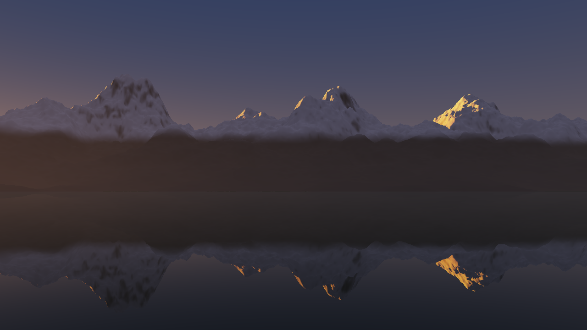

# com.dan.horizon – Licht im Gebirge

**Stand: aus LituyaBay1958 Werkbuch Welle W1 „Licht“ (dazu K16 aus W5), herausgezogen am 07.11.2026.** Bergschatten aus Horizontkarten, die Sonne am Punkt mit ihrer Luftmasse (das Alpenglühen), Luftperspektive in zwei Schichten und das Himmelslicht nach der Richtung einer Fläche. Das Package kennt keine Szene und keinen Himmel: Gelände kommt als Gitter von Höhen, der Himmel als Zahlen und als Rundumbild. Zum Herauskopieren reicht `src/com/dan/horizon/`. Der Kern braucht nur Java 21, `gl/` JOGL (OpenGL 4.3, Compute-Shader).



## Rechnung

| Schritt | Wie |
|---|---|
| Horizontkarte | je Bodenpunkt der höchste Winkel des Geländes in Richtung des Sonnen-Azimuts: Strahl mit wachsender Schrittweite (erst 0,75 Zellen, dann 2,2 % der Entfernung), bis 90 km und 420 Schritte; Erdkrümmung mit Brechung (wirksamer Radius R/(1 − k), k = 0,13); mindestens die Kimm des Meers aus der Höhe des Punkts. Aus 4 000 m liegt die Kimm 1,89° tief |
| Zwei Gitter | ein feines über den Kern (in Lituya 24 km zu 2048², 11,7 m) und ein grobes über die Szene (66 km zu 1024², 64 m) für die fernen Gipfel, die Schatten werfen; dahinter Meer |
| Wann neu | die Karte gilt für jede Sonnenhöhe bei einem Azimut; neu nur, wenn das Azimut um mehr als 0,25° wandert (`azimuthStep`). In Lituya 83–106 ms je Paar auf der Radeon |
| Sonne ja/nein | Horizontwinkel gegen Sonnenhöhe, weich über die Scheibe (±0,0046 rad, `penumbra`); ein Punkt h m über dem Boden sieht um h/2000 rad mehr (Hindernis in rund 2 km, `liftDistance`) [G]. In den Shadern als Konstanten `HZ_PENUMBRA`, `HZ_LIFT` (gleiche Rundung wie zuvor in LituyaBay1958) |
| Sonne am Punkt | Durchlass je Farbe: Rayleigh (Zenit 0,046 / 0,108 / 0,265, Skalenhöhe 8 km) und Dunst (0,10, 1,2 km) [G]; Luftmasse nach Kasten und Young (1989), unter der Waagerechten streifend nach Chapman über die Tangentenhöhe. Auf 4 000 m bei 0,5° unter der Kimm rund ein Fünftel im Rot, Blau fast null: das Alpenglühen steigt beim Sinken der Sonne von selbst die Hänge hinauf |
| Luftperspektive | zwei Schichten: Luft 8 km Skalenhöhe und 150 km Länge, Dunst 1,2 km mit der Sicht des Tages, mit 0,45 gewichtet [G]; gezählt in der mittleren Höhe des Wegs, so stehen Gipfel klar über dem Dunst einer Bucht |
| Dunst für Dinge | `Aerial.fogDistanceAt(h, β)`: gleichwertige Entfernung für Wald, Fälle, Boote in ihrer Höhe (in Lituya K16: vorher volle Bodenextinktion, die Kronen standen orange über dem Hang) |
| Himmelslicht | aus einem Rundumbild des Himmels in Mip-Stufe 6 (rund 45°) in Richtung der Normale, etwas angehoben; in der Helligkeit an das Mittel gebunden; dazu schwaches warmes Licht vom Boden [G]. Hänge zum hellen Abendhimmel bekommen das warme Licht der Kimm, Hänge zur Erdschattenseite das kühle |
| Dunstfarbe | das Rundumbild 3 % über der Kimm in Mip-Stufe 4, in der Helligkeit auf das Dreifache des Himmelslichts begrenzt |

## Klassen

| Klasse | Aufgabe |
|---|---|
| `Horizon` | Karte ohne Grafikkarte (`map`, `angle`, gleiche Rechnung wie der Shader), `visibility`, `seaDip`, `moved`; `Horizon.Grid` (Höhen, `sample`, `sampleRaw`, `at`); Stufen `LOW` bis `ULTRA` (feines/grobes Gitter 512/256 bis 4096/2048) |
| `Airmass` | Luftmasse (`relative`), Durchlass (`transmittance`), Tangentenhöhe |
| `Aerial` | optische Dicke der Luftperspektive, Anteil, gleichwertige Entfernung in einer Höhe |
| `gl/HorizonGl` | Höhen hochladen, beide Karten rechnen (`horizon.comp`), Karte „Sonne“ von oben (`sunmap.comp`, R8, für `forest` und Wasser), Uniforms für Shader des Wirts (`bind`) |
| `gl/horizon.glsl` | Bausteine für Shader des Wirts: `horizonSun`, `horizonTransmittance`, `horizonAirmass`, `horizonAerialDepth`, `horizonHaze`, `horizonSkyLight`, `horizonPanoUV` |
| `demo/HorizonDemo` | Kette an einer Bucht in der Dämmerung, ohne Grafikkarte gerechnet, Regler für die Sonnenhöhe; `--bild datei.png [Sonnenhöhe°] [Breite]` |
| `demo/HorizonCheck` | Prüfung ohne Grafikkarte |

## Einbau

```java
Horizon hz = new Horizon();
Horizon.Grid fein = Horizon.Grid.sample(gelaende, x0, z0, 24_000, 2048, 0);    // Meer und Lücken: 0
Horizon.Grid grob = Horizon.Grid.sample(gelaende, gx0, gz0, 66_000, 1024, 0);
HorizonGl hgl = new HorizonGl(hz);
hgl.init(gl);
hgl.heights(gl, fein, grob);
// je Bild:
hgl.update(gl, Horizon.azimuth(sonnenRichtung));          // rechnet nur, wenn die Sonne weitergewandert ist
int sonne = hgl.sunMap(gl, sonnenRichtung[1], sonnenRichtung, 30);   // für ForestGl.Light.shadowTexture
// in jedem Programm, das horizon.glsl einbindet:
hgl.bind(gl, programm, 13, 14);
```

```glsl
#include "/com/dan/horizon/gl/horizon.glsl"
vec3 sonne = uSonneAussen * horizonTransmittance(max(w.y, 0.0), uSun.y) * horizonSun(w, uSun.y);
float od = horizonAerialDepth(dist, max(0.0, uCam.y + dir.y * dist * 0.5), uDunst);
col = mix(col, horizonHaze(uPano, dir, uHimmelslicht), 1.0 - exp(-od));
```

Wer `penumbra` oder `liftDistance` ändert, setzt vor das Einbinden von `horizon.glsl` dieselben Zeilen, die `HorizonGl` für seine eigenen Shader nimmt: `hgl.defines()` (leer bei der Vorgabe).

Ein Wirt kann der Karte „Sonne“ einen eigenen Schatten mitgeben, etwa Wolken: `hgl.sunMapHost` ersetzt `sunmap_host.glsl` (eine Funktion `float hzHostShadow(vec3 w, vec3 sunDir)`), `hgl.sunMapUniforms` setzt deren Uniforms. LituyaBay1958 gibt so die Wolkenschatten aus `com.dan.cloud` mit.

## Prüfung

`HorizonCheck`: Kimm aus 4 000 m (1,89°), flaches Land, ein Grat von 500 m (Winkel nach der Formel mit Krümmung, Schritte rund 110 m), kein Schatten im Rücken, Schattenlänge bei 3° Sonne, Krümmung in 60 km (246 m), Halbschatten und Hub, Luftmasse im Zenit, bei 30° und an der Kimm (rund 38), stetig über die Waagerechte, Alpenglühen (Rot 0,22, Blau fast null), Mittag, Dunst im Tal und über dem Kamm, Dunst des Walds, Wiederholbarkeit, Wandern des Azimuts. Die Shader `horizon.comp` und `sunmap.comp` wurden mit Mesa gegen die Fassung in LituyaBay1958 geprüft (gleiche Werte).

## Grenzen

- Die Karte sieht nur das Gelände: Bäume, Gebäude und Wolken werfen hier keinen Schatten (Wolken über `sunMapHost`).
- Der Halbschatten nimmt ein Hindernis in rund 2 km an; nahe, steile Hindernisse geben einen zu weichen Rand.
- Die Luftmasse ist für eine Erde ohne Gebirge gerechnet: der Strahl eines Gipfels über einen fernen Kamm ist nur über die Karte geschattet, nicht dichter.
- Himmelslicht und Dunstfarbe brauchen ein Rundumbild mit Mip-Stufen (etwa `com.dan.sky`, `SkyGl.drawPanorama`).

## Quellen

- F. Kasten, A. T. Young (1989): Revised optical air mass tables and approximation formula. Applied Optics 28 (22), 4735–4738.
- S. Chapman (1931): The absorption and ionising effect of monochromatic radiation in an atmosphere on a rotating earth. Proc. Phys. Soc. 43, 483–501 (streifender Strahl).
- Brechung k ≈ 0,13: übliche Normalbrechung der Geodäsie (Gauß; Hirt et al. 2010, J. Geodesy 84, 529–537).
- Rayleigh-Dicken nach Bucholtz (1995), Applied Optics 34 (15), 2765–2773, auf drei Farben gemittelt.
