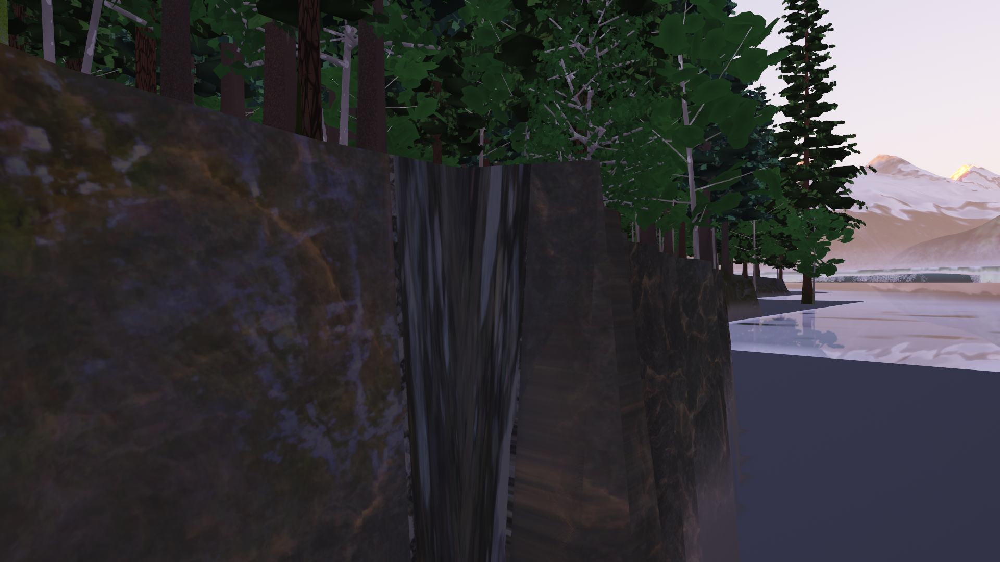
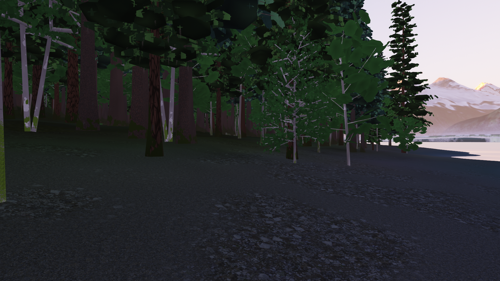

# com.dan.shore – Strand und Böschung an der Naht von Land und Grund

**Stand: LituyaBay1958 W9c Runde 2b** (seit W6 Runde 8). Höhenmodelle für Küsten werden aus zwei Quellen gemischt: einem Landmodell (Lidar, IfSAR) und einem Modell des Grunds (Lotungen, BlueTopo, USACE). An der Wasserlinie passen sie selten zusammen. Das Landmodell legt das Wasser auf eine glatte Fläche („hydroflattened“), das Grundmodell ist an der Küste grob und liegt dort zu tief, und die Zone zwischen den Gezeiten fehlt oft in beiden. Im Bild steht dann eine senkrechte Wand von einigen Metern mit gerader Oberkante.

Das Package löst das an zwei Stellen:

1. **`HydroFlat`** erkennt die glatte Wasserfläche im Landmodell, damit ein Strand nicht als Wasser gilt.
2. **`ShoreRamp`** hebt den Grund vor einer verbliebenen Stufe auf eine Böschung.

Das Package kennt keine Szene und keine Dateiformate, nur `float[]`-Raster (Zeile für Zeile). Zum Herauskopieren reicht `src/com/dan/shore/`. Es braucht nur Java 21.

## Der Befund in LituyaBay1958





- **Wo:** Südufer der Bucht bei E 350 734, N 6 503 964, Blick 049°. Auf 2 m Abstand springt das Gelände von −2,24 m auf +3,05 m.
- **Was das Lidar 2019 dort hat:** einen Strand. Er fällt von 2,96 m auf 0,80 m über 45 m, Neigung rund 0,05. Danach folgt die Wasserfläche, überall genau 0,800 m (576 438 Zellen der Kachel).
- **Was die Mischregel daraus machte:** Sie lautete „Land unter 3 m über einem Grund, der mehr als 1 m tiefer liegt, ist Wasser“. Danach galt der ganze Strand als Wasser, und an seiner Stelle lag BlueTopo mit −2,2 m.
- **Wie oft:** etwa 54 km Kante im Kern zu 0,5 m und 172 km in der Szene zu 5 m. Die Oberkante liegt fast überall bei genau 3,0 m, der Schwelle der Regel.

## HydroFlat

- **Regel:** Eine Zelle gilt als glattes Wasser, wenn mindestens 5 ihrer 8 Nachbarn bis auf 2 mm dieselbe Höhe haben.
- **Warum das trennt:** Ein Strand fällt. Schon bei 0,05 Neigung sind das 2,5 cm je halbem Meter, und das Lidar rauscht um Zentimeter. Die Wasserfläche dagegen ist ein einziger Wert.
- **Am Rand der Wasserfläche:** Die Zellen haben noch genug gleiche Nachbarn.
- **NaN** ist nie Wasser.

```java
boolean[] wasser = HydroFlat.mask(land, w, h);              // 2 mm, 5 von 8
int klasse = (grund < land - 1 && land < 3 && wasser[i]) ? GRUND : LAND;
```

**Speicher (seit W9c Runde 2b).** Die Aufbereitung von LituyaBay1958 rechnet 15 Kacheln zu je 6,5 Mio. Zellen gleichzeitig; dort zählt jedes Feld je Zelle.

- `mask(v, quelle, w, h, tol, minEqual)` nimmt die Quellen als `int[]` oder als `byte[]` (ein Viertel des Speichers, gleiches Ergebnis).
- `attached` fängt die Anker der Reihe nach an, statt alle auf einmal auf den Stapel zu legen. Der Stapel wächst nur mit der Front der Suche, und das Ergebnis steht im Feld der besuchten Zellen. Vorher waren es ein `int` und zwei `boolean` je Zelle, jetzt ein `boolean`. Gleiches Ergebnis.

## ShoreRamp

- **Was gehoben wird:** der Grund vor jeder Landzelle, die eine Stufe zu einem tieferen Grundnachbarn hat.
- **Form der Böschung** von der Höhe des Lands aus:
  - erst `beachSlope` bis `beachFoot`;
  - dann `foreSlope`;
  - bis sie den alten Grund trifft.
- **Was nie geändert wird:**
  - Land;
  - Grund unter `floor`;
  - Land über `topMax`. Felsufer bleiben steil.
- **Abstand:** Chamfer 5 × 5 (1, √2, √5), nur durch Grund hindurch. Das weicht höchstens 2 % von der Luftlinie ab.
- **Kacheln:** Für saubere Kanten rechnet man je Kachel mit einem Rand von `reach()` Metern und nimmt die Mitte.
- **Zweiter Durchgang:** ändert nichts.

| Wert | Vorgabe | Bedeutung |
|---|---|---|
| `stepMin` | 1,0 m | kleinste Stufe, die eine Böschung bekommt |
| `topMax` | 4,0 m | Quellen nur bis zu dieser Höhe |
| `beachSlope` | 0,10 | Strand |
| `beachFoot` | −2,0 m | Fuß des Strands |
| `foreSlope` | 0,5 | darunter (27°) |
| `floor` | −40 m | tiefer wird nicht gehoben |

Alle Werte sind gestaltet [G]. Für die Kiesstrände der Lituya Bay misst das Lidar über Wasser 0,05 bis 0,1.

```java
ShoreRamp r = new ShoreRamp();
ShoreRamp.Result e = r.apply(hoehe, klasse, w, h, 0.5);   // klasse: ShoreRamp.LAND, ShoreRamp.BED, sonst −1
// e.sources(), e.raised(), e.maxRaise()
int rand = (int) Math.ceil(r.reach() / zelle) + 2;       // Rand je Kachel (Vorgabe 136 m)
```

## Prüfung

`demo/ShoreCheck` läuft ohne Grafikkarte und prüft:

- eine gerade Stufe: die Böschung genau wie `fall()`, 66 m breit;
- Land unverändert;
- zweiter Durchgang ohne Wirkung;
- Felsufer von 30 m und Stufen von 0,5 m ohne Strand;
- schräges Ufer (30°): im Mittel 2 cm neben dem geraden;
- zwei Kacheln mit Rand gleich dem ganzen Raster;
- Grund unter `floor` unverändert;
- glattes Wasser gegen Strand mit Rauschen;
- die Grenze zweier glatter Quellen ist glatt;
- Strand am Land bleibt, eine Insel im Wasser nicht;
- Quellen als `byte` geben dieselbe Maske wie als `int`, und der sparsame Zusammenhang dasselbe wie die Rechnung vorher (je sechs zufällige Felder 300 × 300).

```
java -cp dist/Renderer.jar com.dan.shore.demo.ShoreCheck
```

## Verwendung

LituyaBay1958 nutzt das Package in der Aufbereitung, Schritt `gelaende` (`tools.Gelaende`, Stufen Szene und Kern):

- Die Mischregel fragt `HydroFlat`.
- Strand bleibt nur, wo er mit dem Land über 3 m zusammenhängt (`HydroFlat.attached`). „Glatt“ wird dabei nur gegen Nachbarn derselben Landquelle geprüft, also Lidar gegen Lidar und IfSAR gegen IfSAR (`HydroFlat.mask` mit Quellen). Ohne beides lagen an den Grenzen der Lidarkacheln Rücken mitten im Wasser.
- Danach läuft `ShoreRamp` je Kachel mit Rand.
- Ergebnis der Aufbereitung: im Kern 0,88 km² Strand aus dem Lidar zurück und 2,65 km² Grund gehoben, in der Szene 3,40 km² und 11,65 km².
- Seit W9c Runde 2b mit den Quellen als `byte` und dem sparsamen `attached`: eine Kachel des Kerns braucht rund 100 statt 250 MB, die Kacheln sind Bit für Bit dieselben (geprüft an 20 Kacheln des Kerns und zwei der Szene).
- Schalter `-Dlituya.ohneStrand=true` stellt die Mischung wie vorher her.
