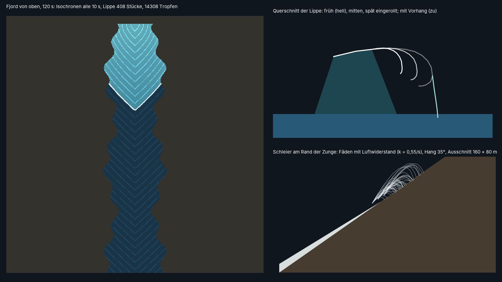

# com.dan.surge – die Front einer Riesenwelle

**Stand: aus LituyaBay1958 Werkbuch Welle W3b bis W5 („Wand statt Ball“, „Kein Becken“, „Die Wand“, „Die Röhre“, „524 m“), herausgezogen am 07.11.2026.** Wie eine Riesenwelle aussieht, die ein Löser als Höhenfeld rechnet: eine brechende Wand mit überhängender Lippe, Röhre, Vorhang und Tropfen, Gischt, die mit der Front läuft, Durchlicht im dünnen Kamm, Walze und Schaumspur, eine Zunge, die einen Hang hinaufschießt, und Schleier, die oben abreißen und zurückfallen. Für einen Tsunami in einem Fjord (Lituya Bay 1958), einen Schwall nach einem Bergsturz in einen Stausee (Vajont 1963, Spirit Lake 1980) oder einen Dammbruch. Das Package kennt keinen Löser und keine Szene: es liest eine **Flutkarte** (je Zelle Ankunft der Front und höchster Stand), die etwa `com.dan.wave` mitschreibt. Zum Herauskopieren reicht `src/com/dan/surge/`. Der Kern braucht nur Java 21, `gl/` JOGL (OpenGL 4.3).



Fast alles hier ist gestaltet [G]: nach den Zeugen von 1958 (Ulrich und Swanson sahen eine Wand, keinen Buckel), nach Bildern von Brechern und Laborversuchen (FRITZ01, Heller 2009), mit echter Ballistik für Tropfen und Fäden. Die Rechnung des Wassers selbst ist nicht hier.

## Die Flutkarte

`FloodMap`: Ankunft (s, NaN nie) und höchster Stand (m, NaN trocken) je Zelle, Zeilen nach Norden. `fillDry(2)` gibt trockenen Zellen am Rand die Ankunft der Nachbarn (die Linie der Front reicht bis an den Rand), `blocks(32, Pegel)` die früheste und späteste Ankunft je Block (schnelles Verwerfen), `sprayBox(t, Pegel, Nachlauf)` die Hülle der Gischt für einen Strahlengang, `smoothedArrival(3)` die Ankunft ohne die Treppe aus den Bildern der Rechnung, `textureData()` die Werte für RG32F (`SurgeGl.floodTexture`). Aus dem Gefälle der Ankunft kommen Laufrichtung und Tempo der Front.

## Was es zeichnet

| Teil | Wo | Wie |
|---|---|---|
| Aufsteilen | `surge_front.glsl` `sgSteepen` | gleich hinter der Ankunftslinie nimmt jede Ecke die höchste Höhe bis D = 5 · Welle (höchstens 240 m) hinter sich, läuft in 2D/60 m/s auf die Rechnung zurück; nur 6–80 m Welle und über tiefem Wasser. Kann nicht falten, die Ankunft bleibt, wo die Rechnung sie hat. Längs der Front geglättet gegen die Treppe des Gitters (`sgAlongSmooth`) |
| Lippe im Höhenfeld | `sgLipShare`, `sgLipAdvance` | ein schmaler Saum hinter der Front (bis rund 3 s) zieht über den Fuß vor, die Spitze sinkt; Abschnitte von rund 100 m brechen zu verschiedenen Zeiten |
| Lippe als Netz | `Lip`, `SurgeGl.drawLip` | Linie der Front 0,35 s hinter dem Fuß, je Punkt ein runder Querschnitt (Rücken, Krone, Bézier-Kurve der Lippe, Rolle), Wurf vom Fuß an (Tempo · 0,35 s + 0,25–0,55 der Höhe), Einrollen, offen oder zu in wandernden Abschnitten (37, 83, 190 m), Vorhang als eigener Streifen bis unter den Pegel |
| Tropfen | `Lip`, `drops.vert/frag` | feste Plätze alle 0,5 m, drei je Platz: von der Spitze (0,35–1,25 s Flug) und am Fuß des Vorhangs (3–12 m/s nach oben und vorn); weiche Punkte in ihrer Größe, kleiner als 1,5 Bildpunkte durchsichtiger statt kleiner |
| Oberfläche | `surge_surface.glsl` `surgeShade` | Körper fjordgrün mit Gletschermilch, nach der Front Schlamm; Kräusel in vier Lagen; steile Wände spiegeln die dunklen Hänge statt der hellen Kimm; Durchlicht im dünnen Kamm; Weißwasser an der Front; Walze mit Schaumfahnen; Kamm, der nicht überall zugleich bricht; durchlüfteter Sturz hoher Wände; Licht im Schaum mit Rinnen; Stämme in der Walze; Schaumstraßen und Teppich mit Wirbeln; Saum am Ufer; Treibgut in Feldern; die Rückwand der Röhre unter dem Netz der Lippe |
| Zunge am Hang | `surgeShade` (`sgTongue`, `sgFinger`) | Vorderkante in Fingern und Loben (bis 1 s verschoben), Weißwasser in Fäden und Ballen (4 und 10 m, mit eigener Normale), braunes Wasser voll Erde, Saum, Stämme längs der Strömung; beim Rückfall dünnes, glänzendes Wasser in Rinnen |
| Gischt | `surge_spray.glsl` `surgeSprayDensity` | über dem Wasser eine Wand, die in 1,5 s auf 12–122 m über den höchsten Stand steigt, zurückfällt und als Schleier verweht; an Land 8 m + 1,3 × Tiefe der Zunge; Kammgischt in Fäden längs der Laufrichtung, die gegen sie zurückweht; Schlamm am Fuß; `surgeTubeMask` lichtet alles vor der Röhre |
| Schleier | `Veil`, `SurgeGl.drawVeil` | am oberen Rand der Zunge je 4 m eine Garbe aus 40 Fäden, Wurf 0,35–0,8 des Tempos der Front, Bahn mit linearem Luftwiderstand (k = 0,55/s) und Schwere, als Striche mit Belichtungszeit |

## Licht

Die Shader des Packages rufen nur den Lichtvertrag aus `gl/light.glsl`: `lightSun(w)`, `lightSky(n)`, `lightSkyDir(d)`, `lightHaze(d)`, `lightAerial(c, d, dist)`, `lightIrradiance()` und die Uniforms `uVP`, `uCam`, `uSun`, `uTime`, `uLevel`, `uFrame`. Die Vorgabe nimmt feste Farben (`SurgeGl.Light`). Ein Wirt mit eigenem Licht ersetzt die Datei (`SurgeGl.hostLight`, GLSL) und setzt seine Uniforms (`SurgeGl.hostUniforms`); LituyaBay1958 gibt so seine Sonne am Punkt mit Bergschatten (`com.dan.horizon`), sein Rundumbild aus `com.dan.sky`, die Wolkenschatten und die Luftperspektive mit:

```glsl
#include "common.glsl"            // Lichtblock des Wirts
#define lightSun sunAt
#define lightSky umgebung
#define lightSkyDir skyColor
#define lightHaze hazeColor
#define lightAerial aerial
#define uFrame uBild
vec3 lightIrradiance() { return uSkyMode == 1 ? uSkyAmb * 3.14159 : skyColor(vec3(0.0, 1.0, 0.0)) * 0.6; }
```

## Einbau

```java
FloodMap flut = new FloodMap(nx, nz, 8, x0, zSued, ankunft, stand).fillDry(2);
flut.blocks(32, pegel);
int flutTex = SurgeGl.floodTexture(gl, flut, 0);
Surge welle = Surge.lituya1958();
SurgeGl sg = new SurgeGl();  sg.init(gl);
sg.setVeil(gl, welle.veil.threads(max, ankunft, grund, fnx, fnz, 2, Veil.grid(fx0, fzSued, 2)));   // einmal je Lauf
// je Bild:
welle.lip.build(flut, t, auge[0], auge[2], pegel, (x, z) -> grund(x, z));
sg.drawLip(gl, welle.lip, blick, licht);
sg.drawVeil(gl, blick, licht, t);
```

Eckenformer des Wirts (sein Höhenfeld):

```glsl
#include "/com/dan/surge/gl/surge_front.glsl"
float surgeHeight(ivec2 c, out float wet) { return hoehe(c, wet); }   // Höhe der Fläche an einer Zelle
// vec4 lf = sgFront(xz);  float D = sgSteepenLength(max(lf.w - uLevel, 0.0), 1.0);  h = sgSteepen(c, h, nass, lf.z, lf.xy, D, 2.0 * D / 60.0, zelle, schritt);
```

Bildpunktformer:

```glsl
#include "/com/dan/surge/gl/surge_surface.glsl"
SurgeSurf s = SurgeSurf(vW, vN, vNass, vH, vSteig, vTiefe, vQuelle, vLippe, vLauf, vSeit, vStand);
frag = surgeShade(s);
```

Die Uniforms der Flutkarte setzt `SurgeGl.bindFlood(gl, programm, an, stelle, flutTex, flut.rect(), t)`; dazu `uSgWind`, `uSgLipMesh`, `uSgEarly`, `uSgLipAdvance`. Einen Spiegel der Szene gibt der Wirt mit `#define SURGE_MIRROR` und einer Funktion `surgeMirror(...)` dazu. Für die Gischt im eigenen Strahlengang `surge_spray.glsl` mit `uSgSpray`, `uSgBed`, `uSgBedRect` und `uSgNoise` (`SurgeGl.noiseTexture`). Die vollständige Anwendung steht in LituyaBay1958: `spur.vert`, `welle.frag`, `medien.frag`, `EreignisGl`.

## Klassen

| Klasse | Aufgabe |
|---|---|
| `FloodMap` | Flutkarte: Füllen, Blöcke, Hülle der Gischt, geglättete Ankunft, Textur |
| `Lip` | Linie der Front, Querschnitte, Vorhang, Tropfen (`build`, `section`) |
| `Veil` | Fäden der Schleier am Auflauf (`threads`), Bahn (`position`) |
| `Front` | die Regeln der Shader als Formeln (Aufsteilen, Lippe, Gischtwand) |
| `Surge` | Lippe und Schleier mit Qualitätsstufen `LOW` bis `ULTRA`, `lituya1958()` |
| `Noise` | kachelbares Rauschen 64³ für die Gischt |
| `gl/SurgeGl` | Lippe, Tropfen, Schleier zeichnen; Flutkarte als Textur; Rauschen; Lichtvertrag mit Wirt |
| `gl/surge_front.glsl`, `surge_surface.glsl`, `surge_spray.glsl`, `surge_flood.glsl`, `surge_noise.glsl` | Bausteine für die Shader eines Wirts |
| `demo/SurgeDemo` | Schaubild ohne Grafikkarte, Zeitregler; `--bild datei.png [Zeit s] [Breite]` |
| `demo/SurgeCheck` | Prüfung ohne Grafikkarte |

## Prüfung

`SurgeCheck` an einer kreisrunden Front (40 m/s, 12 × 12 km zu 8 m): Füllen, Textur, Hülle wächst; Linie der Lippe genau bei 40 m/s · (t − 0,35 s), Laufrichtung radial, Normalen, Spitze bei 0,60–0,74 der Höhe, Vorhang unter dem Pegel, Tropfen über dem Wasser, wiederholbar, kein Brechen über flachem Wasser und außerhalb des Umkreises; Schleier am Rand der Zunge an einem Hang von 45°, Abwurf nach der Ankunft, Wurf begrenzt, wiederholbar, Bahn gegen v₀/k und g/k; Aufsteilen, Lippe, Gischtwand; Rauschen; Stufen. Die Shader wurden mit Mesa gegen die Fassung in LituyaBay1958 geprüft (gleiche Werte), die Ecken und Fäden auf dem Prozessor (gleich bis aufs Bit).

## Grenzen

- Kein Löser: Höhe, Tempo und Richtung der Front stammen aus der Flutkarte; die Lippe ist gestaltet, nicht gerechnet (kein SPH, kein VOF).
- Der Vorhang ist eine Fläche mit Strängen und Löchern, kein Volumen; Kammgischt und Gischtwand sind Dichten im Strahl des Wirts, keine Teilchen.
- Tropfen ohne Bewegungsunschärfe (die gibt der Wirt, etwa `com.dan.shutter`).
- Die Zunge braucht ein Höhenfeld mit Grund (Tiefe je Ecke), sonst gibt es keine Unterscheidung zwischen Wasser und Land.

## Quellen

- D. J. Miller (1960): Giant waves in Lituya Bay, Alaska. USGS Professional Paper 354-C (Zeugen, Auflauf 524 m).
- H. M. Fritz, W. H. Hager, H.-E. Minor (2001): Lituya Bay case: rockslide impact and wave run-up. Science of Tsunami Hazards 19 (1), 3–22 (FRITZ01).
- V. Heller, W. H. Hager (2010): Impulse product parameter in landslide generated impulse waves. J. Waterway, Port, Coastal, Ocean Eng. 136 (3), 145–155.
- D. H. Peregrine (1983): Breaking waves on beaches. Annu. Rev. Fluid Mech. 15, 149–178 (Lippe, Röhre, Vorhang).
- Linearer Luftwiderstand für Tropfenwolken: gestaltet nach Fallgeschwindigkeiten von Tropfen 1–3 mm (Gunn und Kinzer 1949, J. Meteor. 6, 243–248).
